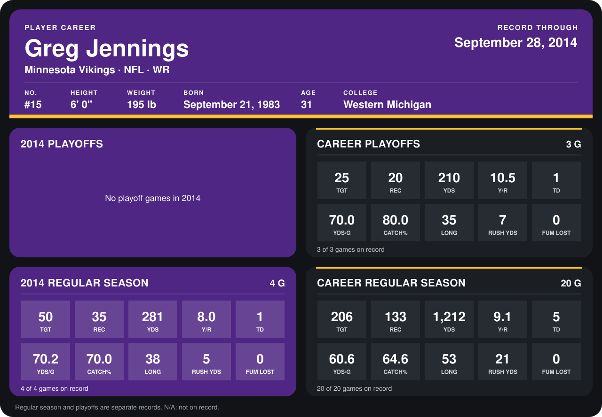

# Greg Jennings

## Career stats

### Regular season

| Season | Club | G | TGT | REC | YDS | Y/R | TD | YDS/G | CATCH% | LONG | RUSH YDS | FUM LOST |
|---|---|---:|---:|---:|---:|---:|---:|---:|---:|---:|---:|---:|
| 2013 | Minnesota Vikings | 16 | 156 | 98 | 931 | 9.5 | 4 | 58.2 | 62.8 | 53 | 16 | 0 |
| 2014 | Minnesota Vikings | 4 | 50 | 35 | 281 | 8.0 | 1 | 70.2 | 70.0 | 38 | 5 | 0 |
| **Career** |  | 20 | 206 | 133 | 1,212 | 9.1 | 5 | 60.6 | 64.6 | 53 | 21 | 0 |

### Playoffs

| Season | Club | G | TGT | REC | YDS | Y/R | TD | YDS/G | CATCH% | LONG | RUSH YDS | FUM LOST |
|---|---|---:|---:|---:|---:|---:|---:|---:|---:|---:|---:|---:|
| 2013 | Minnesota Vikings | 3 | 25 | 20 | 210 | 10.5 | 1 | 70.0 | 80.0 | 35 | 7 | 0 |
| **Career** |  | 3 | 25 | 20 | 210 | 10.5 | 1 | 70.0 | 80.0 | 35 | 7 | 0 |

## Awards

None on record.

Records through September 28, 2014. Identity: listed 2014 roster data, Weeks 1-4; number: 2014 Week 1 roster. [All Minnesota Vikings players](README.md).
