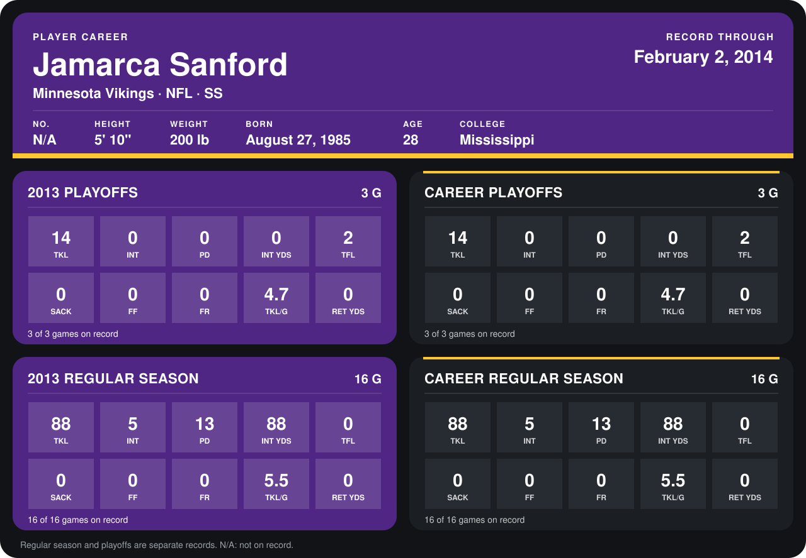

# Jamarca Sanford

## Career stats

### Regular season

| Season | Team | Age | # | G | TKL | INT | PD | INT YDS | TFL | SACK | FF | FR | TKL/G | RET YDS |
|---|---|---:|---:|---:|---:|---:|---:|---:|---:|---:|---:|---:|---:|---:|
| 2013 | Minnesota Vikings | 28 | 33 | 16 | 88 | 5 | 13 | 88 | 0 | 0 | 0 | 0 | 5.5 | 0 |
| **Career** |  |  |  | 16 | 88 | 5 | 13 | 88 | 0 | 0 | 0 | 0 | 5.5 | 0 |

### Playoffs

| Season | Team | Age | # | G | TKL | INT | PD | INT YDS | TFL | SACK | FF | FR | TKL/G | RET YDS |
|---|---|---:|---:|---:|---:|---:|---:|---:|---:|---:|---:|---:|---:|---:|
| 2013 | Minnesota Vikings | 28 | 33 | 3 | 14 | 0 | 0 | 0 | 2 | 0 | 0 | 0 | 4.7 | 0 |
| **Career** |  |  |  | 3 | 14 | 0 | 0 | 0 | 2 | 0 | 0 | 0 | 4.7 | 0 |

## Awards

None on record.

Age is his age on the league's opening game of each season; # is the number listed for him that season with that team (2014: the card's rule; 2013: the 2013 season roster), N/A where no listing applies.

Records through February 2, 2014. Identity: his listed 2013 season roster data (no 2014 Weeks 1-4 roster row). [All Minnesota Vikings players](README.md).
