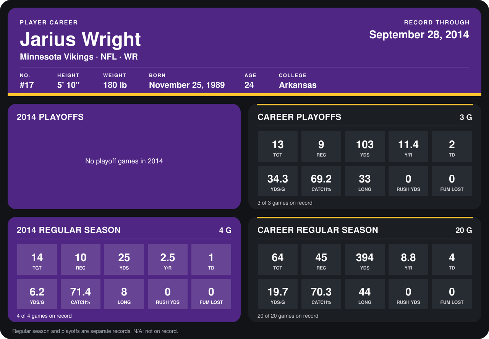

# Jarius Wright

## Career stats

### Regular season

| Season | Team | Age | # | G | TGT | REC | YDS | Y/R | TD | YDS/G | CATCH% | LONG | RUSH YDS | FUM LOST |
|---|---|---:|---:|---:|---:|---:|---:|---:|---:|---:|---:|---:|---:|---:|
| 2013 | Minnesota Vikings | 23 | 17 | 16 | 50 | 35 | 369 | 10.5 | 3 | 23.1 | 70.0 | 44 | 0 | 0 |
| 2014 | Minnesota Vikings | 24 | 17 | 5 | 18 | 11 | 59 | 5.4 | 2 | 11.8 | 61.1 | 34 | 0 | 0 |
| **Career** |  |  |  | 21 | 68 | 46 | 428 | 9.3 | 5 | 20.4 | 67.6 | 44 | 0 | 0 |

### Playoffs

| Season | Team | Age | # | G | TGT | REC | YDS | Y/R | TD | YDS/G | CATCH% | LONG | RUSH YDS | FUM LOST |
|---|---|---:|---:|---:|---:|---:|---:|---:|---:|---:|---:|---:|---:|---:|
| 2013 | Minnesota Vikings | 23 | 17 | 3 | 13 | 9 | 103 | 11.4 | 2 | 34.3 | 69.2 | 33 | 0 | 0 |
| **Career** |  |  |  | 3 | 13 | 9 | 103 | 11.4 | 2 | 34.3 | 69.2 | 33 | 0 | 0 |

## Awards

None on record.

Age is his age on the league's opening game of each season; # is the number listed for him that season with that team (2014: the card's rule; 2013: the 2013 season roster), N/A where no listing applies.

Records through October 2, 2014. Identity: listed 2014 roster data, Weeks 1-4; number: 2014 Week 1 roster. [All Minnesota Vikings players](README.md).
