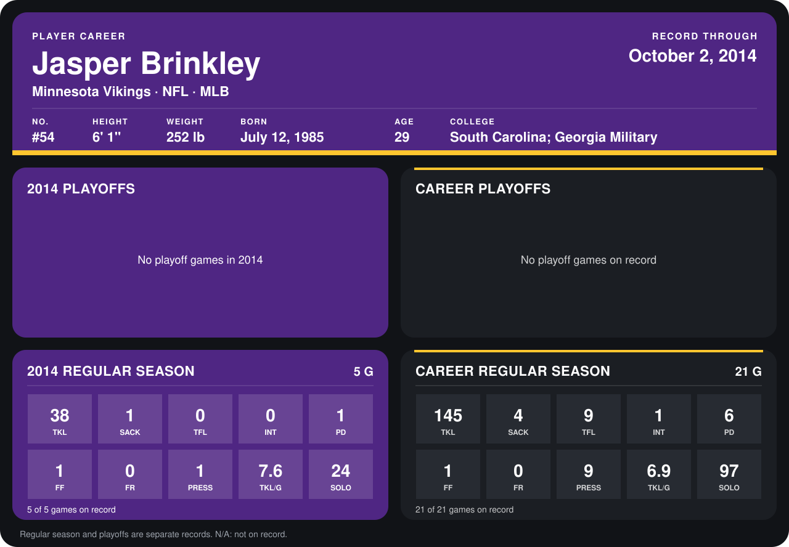

# Jasper Brinkley

## Career stats

### Regular season

| Season | Club | G | TKL | SACK | TFL | INT | PD | FF | FR | PRESS | TKL/G | SOLO |
|---|---|---:|---:|---:|---:|---:|---:|---:|---:|---:|---:|---:|
| 2013 | Arizona Cardinals | 16 | 107 | 3 | 9 | 1 | 5 | 0 | 0 | 8 | 6.7 | 73 |
| 2014 | Minnesota Vikings | 4 | 32 | 0 | 0 | 0 | 1 | 0 | 0 | 0 | 8.0 | 21 |
| **Career** |  | 20 | 139 | 3 | 9 | 1 | 6 | 0 | 0 | 8 | 7.0 | 94 |

### Playoffs

No playoff games on record.

## Awards

None on record.

Records through September 28, 2014. Identity: listed 2014 roster data, Weeks 1-4; number: 2014 Week 1 roster. [All Minnesota Vikings players](README.md).
