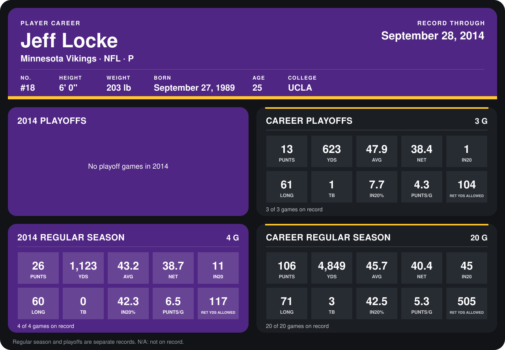

# Jeff Locke

## Career stats

### Regular season

| Season | Club | G | PUNTS | YDS | AVG | NET | IN20 | LONG | TB | IN20% | PUNTS/G | RET YDS ALLOWED |
|---|---|---:|---:|---:|---:|---:|---:|---:|---:|---:|---:|---:|
| 2013 | Minnesota Vikings | 16 | 80 | 3,726 | 46.6 | 41.0 | 34 | 71 | 3 | 42.5 | 5.0 | 388 |
| 2014 | Minnesota Vikings | 4 | 26 | 1,123 | 43.2 | 38.7 | 11 | 60 | 0 | 42.3 | 6.5 | 117 |
| **Career** |  | 20 | 106 | 4,849 | 45.7 | 40.4 | 45 | 71 | 3 | 42.5 | 5.3 | 505 |

### Playoffs

| Season | Club | G | PUNTS | YDS | AVG | NET | IN20 | LONG | TB | IN20% | PUNTS/G | RET YDS ALLOWED |
|---|---|---:|---:|---:|---:|---:|---:|---:|---:|---:|---:|---:|
| 2013 | Minnesota Vikings | 3 | 13 | 623 | 47.9 | 38.4 | 1 | 61 | 1 | 7.7 | 4.3 | 104 |
| **Career** |  | 3 | 13 | 623 | 47.9 | 38.4 | 1 | 61 | 1 | 7.7 | 4.3 | 104 |

## Awards

- AP Second-Team All-Pro (2013, P)
- Pro Bowl selection (2013, P)

Records through September 28, 2014. Identity: listed 2014 roster data, Weeks 1-4; number: 2014 Week 1 roster. [All Minnesota Vikings players](README.md).
