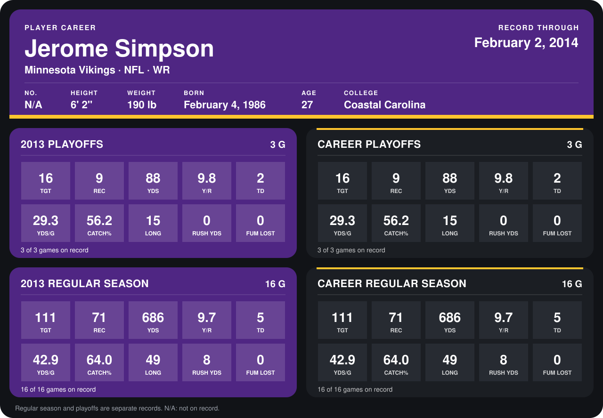

# Jerome Simpson

## Career stats

### Regular season

| Season | Club | G | TGT | REC | YDS | Y/R | TD | YDS/G | CATCH% | LONG | RUSH YDS | FUM LOST |
|---|---|---:|---:|---:|---:|---:|---:|---:|---:|---:|---:|---:|
| 2013 | Minnesota Vikings | 16 | 111 | 71 | 686 | 9.7 | 5 | 42.9 | 64.0 | 49 | 8 | 0 |
| **Career** |  | 16 | 111 | 71 | 686 | 9.7 | 5 | 42.9 | 64.0 | 49 | 8 | 0 |

### Playoffs

| Season | Club | G | TGT | REC | YDS | Y/R | TD | YDS/G | CATCH% | LONG | RUSH YDS | FUM LOST |
|---|---|---:|---:|---:|---:|---:|---:|---:|---:|---:|---:|---:|
| 2013 | Minnesota Vikings | 3 | 16 | 9 | 88 | 9.8 | 2 | 29.3 | 56.2 | 15 | 0 | 0 |
| **Career** |  | 3 | 16 | 9 | 88 | 9.8 | 2 | 29.3 | 56.2 | 15 | 0 | 0 |

## Awards

None on record.

Records through September 29, 2014. Identity: the public player file's latest listing (no 2014 Weeks 1-4 roster row). [All Minnesota Vikings players](README.md).
