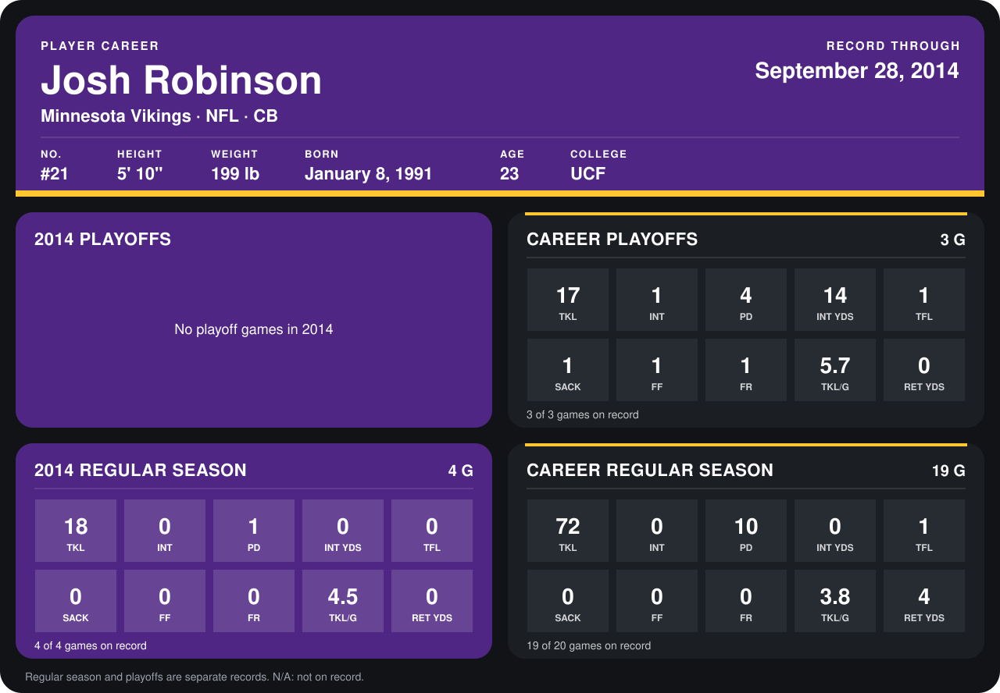

# Josh Robinson

## Career stats

### Regular season

| Season | Club | G | TKL | INT | PD | INT YDS | TFL | SACK | FF | FR | TKL/G | RET YDS |
|---|---|---:|---:|---:|---:|---:|---:|---:|---:|---:|---:|---:|
| 2013 | Minnesota Vikings | 15 | 54 | 0 | 9 | 0 | 1 | 0 | 0 | 0 | 3.6 | 4 |
| 2014 | Minnesota Vikings | 4 | 18 | 0 | 1 | 0 | 0 | 0 | 0 | 0 | 4.5 | 0 |
| **Career** |  | 19 | 72 | 0 | 10 | 0 | 1 | 0 | 0 | 0 | 3.8 | 4 |

### Playoffs

| Season | Club | G | TKL | INT | PD | INT YDS | TFL | SACK | FF | FR | TKL/G | RET YDS |
|---|---|---:|---:|---:|---:|---:|---:|---:|---:|---:|---:|---:|
| 2013 | Minnesota Vikings | 3 | 17 | 1 | 4 | 14 | 1 | 1 | 1 | 1 | 5.7 | 0 |
| **Career** |  | 3 | 17 | 1 | 4 | 14 | 1 | 1 | 1 | 1 | 5.7 | 0 |

## Awards

None on record.

Records through September 29, 2014. Identity: listed 2014 roster data, Weeks 1-4; number: 2014 Week 1 roster. [All Minnesota Vikings players](README.md).
