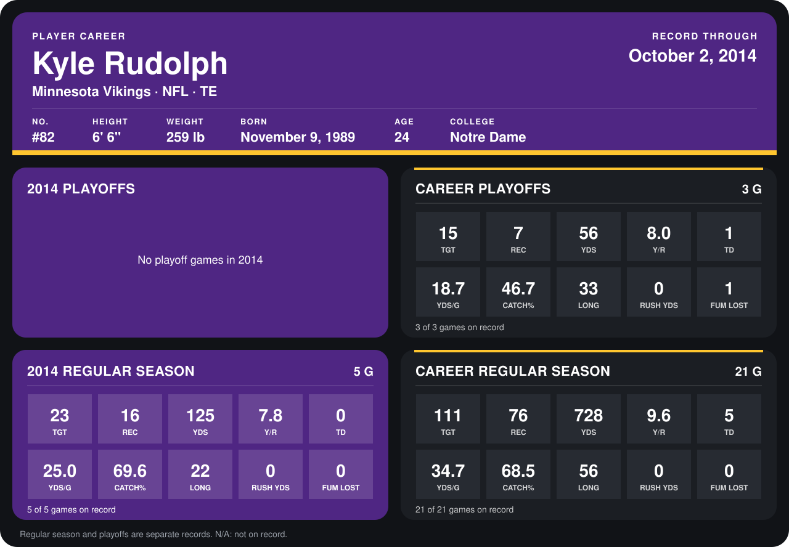

# Kyle Rudolph

## Career stats

### Regular season

| Season | Club | G | TGT | REC | YDS | Y/R | TD | YDS/G | CATCH% | LONG | RUSH YDS | FUM LOST |
|---|---|---:|---:|---:|---:|---:|---:|---:|---:|---:|---:|---:|
| 2013 | Minnesota Vikings | 16 | 88 | 60 | 603 | 10.1 | 5 | 37.7 | 68.2 | 56 | 0 | 0 |
| 2014 | Minnesota Vikings | 4 | 20 | 14 | 108 | 7.7 | 0 | 27.0 | 70.0 | 22 | 0 | 0 |
| **Career** |  | 20 | 108 | 74 | 711 | 9.6 | 5 | 35.5 | 68.5 | 56 | 0 | 0 |

### Playoffs

| Season | Club | G | TGT | REC | YDS | Y/R | TD | YDS/G | CATCH% | LONG | RUSH YDS | FUM LOST |
|---|---|---:|---:|---:|---:|---:|---:|---:|---:|---:|---:|---:|
| 2013 | Minnesota Vikings | 3 | 15 | 7 | 56 | 8.0 | 1 | 18.7 | 46.7 | 33 | 0 | 1 |
| **Career** |  | 3 | 15 | 7 | 56 | 8.0 | 1 | 18.7 | 46.7 | 33 | 0 | 1 |

## Awards

None on record.

Records through September 28, 2014. Identity: listed 2014 roster data, Weeks 1-4; number: 2014 Week 1 roster. [All Minnesota Vikings players](README.md).
