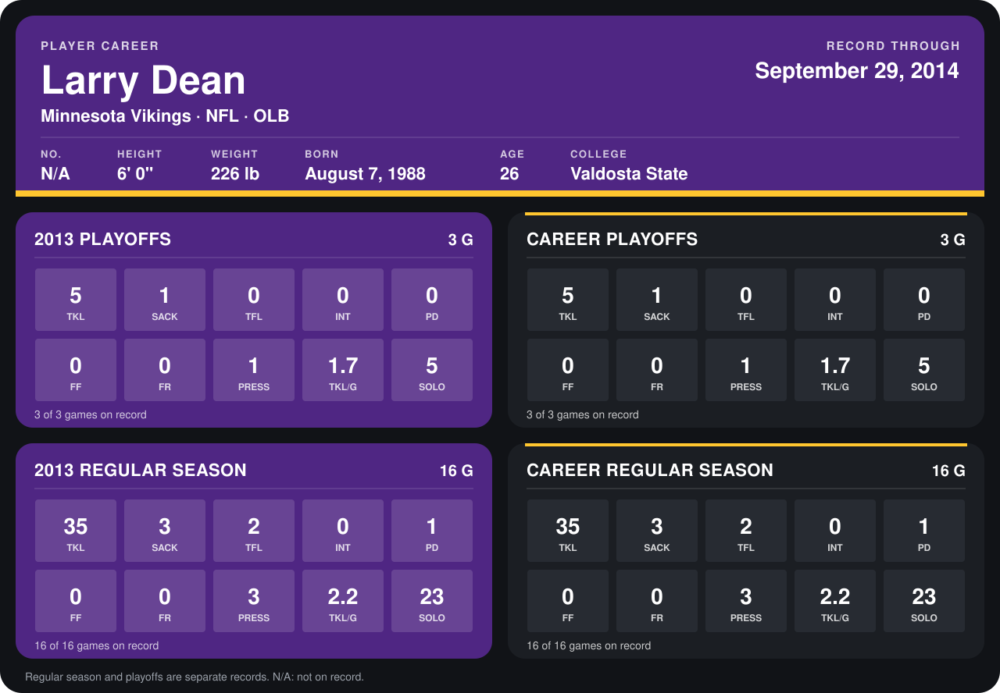

# Larry Dean

## Career stats

### Regular season

| Season | Club | G | TKL | SACK | TFL | INT | PD | FF | FR | PRESS | TKL/G | SOLO |
|---|---|---:|---:|---:|---:|---:|---:|---:|---:|---:|---:|---:|
| 2013 | Minnesota Vikings | 16 | 35 | 3 | 2 | 0 | 1 | 0 | 0 | 3 | 2.2 | 23 |
| **Career** |  | 16 | 35 | 3 | 2 | 0 | 1 | 0 | 0 | 3 | 2.2 | 23 |

### Playoffs

| Season | Club | G | TKL | SACK | TFL | INT | PD | FF | FR | PRESS | TKL/G | SOLO |
|---|---|---:|---:|---:|---:|---:|---:|---:|---:|---:|---:|---:|
| 2013 | Minnesota Vikings | 3 | 5 | 1 | 0 | 0 | 0 | 0 | 0 | 1 | 1.7 | 5 |
| **Career** |  | 3 | 5 | 1 | 0 | 0 | 0 | 0 | 0 | 1 | 1.7 | 5 |

## Awards

None on record.

Records through February 2, 2014. Identity: listed 2014 roster data, Weeks 1-4. [All Minnesota Vikings players](README.md).
