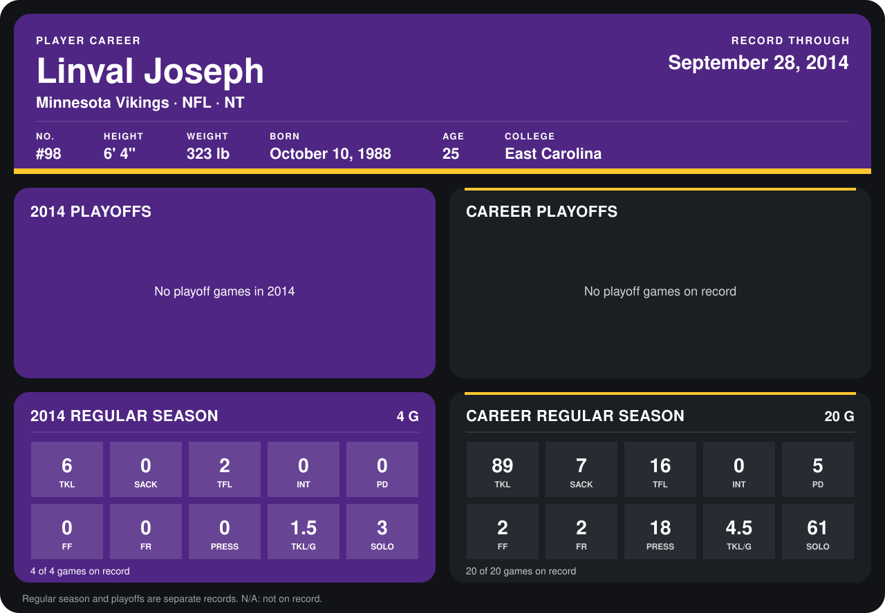

# Linval Joseph

## Career stats

### Regular season

| Season | Team | Age | # | G | TKL | SACK | TFL | INT | PD | FF | FR | PRESS | TKL/G | SOLO |
|---|---|---:|---:|---:|---:|---:|---:|---:|---:|---:|---:|---:|---:|---:|
| 2013 | New York Giants | 24 | 97 | 16 | 83 | 7 | 14 | 0 | 5 | 2 | 2 | 18 | 5.2 | 58 |
| 2014 | Minnesota Vikings | 25 | 98 | 5 | 10 | 0 | 2 | 0 | 0 | 0 | 0 | 0 | 2.0 | 6 |
| **Career** |  |  |  | 21 | 93 | 7 | 16 | 0 | 5 | 2 | 2 | 18 | 4.4 | 64 |

### Playoffs

No playoff games on record.

## Awards

- AP Second-Team All-Pro (2013, DT)
- Pro Bowl selection (2013, DT)

Age is his age on the league's opening game of each season; # is the number listed for him that season with that team (2014: the card's rule; 2013: the 2013 season roster), N/A where no listing applies.

Records through October 2, 2014. Identity: listed 2014 roster data, Weeks 1-4; number: 2014 Week 1 roster. [All Minnesota Vikings players](README.md).
