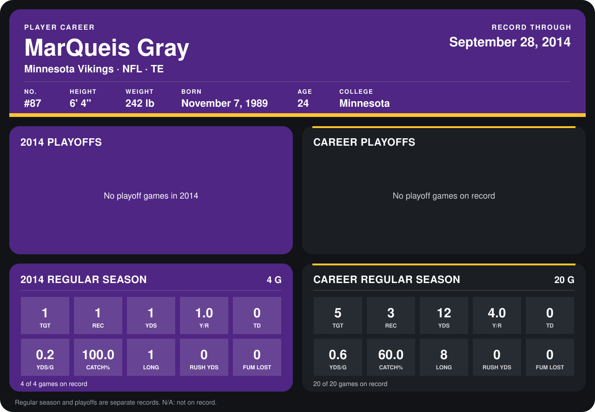

# MarQueis Gray

## Career stats

### Regular season

| Season | Club | G | TGT | REC | YDS | Y/R | TD | YDS/G | CATCH% | LONG | RUSH YDS | FUM LOST |
|---|---|---:|---:|---:|---:|---:|---:|---:|---:|---:|---:|---:|
| 2013 | Cleveland Browns | 16 | 4 | 2 | 11 | 5.5 | 0 | 0.7 | 50.0 | 8 | 0 | 0 |
| 2014 | Minnesota Vikings | 5 | 1 | 1 | 1 | 1.0 | 0 | 0.2 | 100.0 | 1 | 0 | 0 |
| **Career** |  | 21 | 5 | 3 | 12 | 4.0 | 0 | 0.6 | 60.0 | 8 | 0 | 0 |

### Playoffs

No playoff games on record.

## Awards

None on record.

Records through October 2, 2014. Identity: listed 2014 roster data, Weeks 1-4; number: 2014 Week 1 roster. [All Minnesota Vikings players](README.md).
