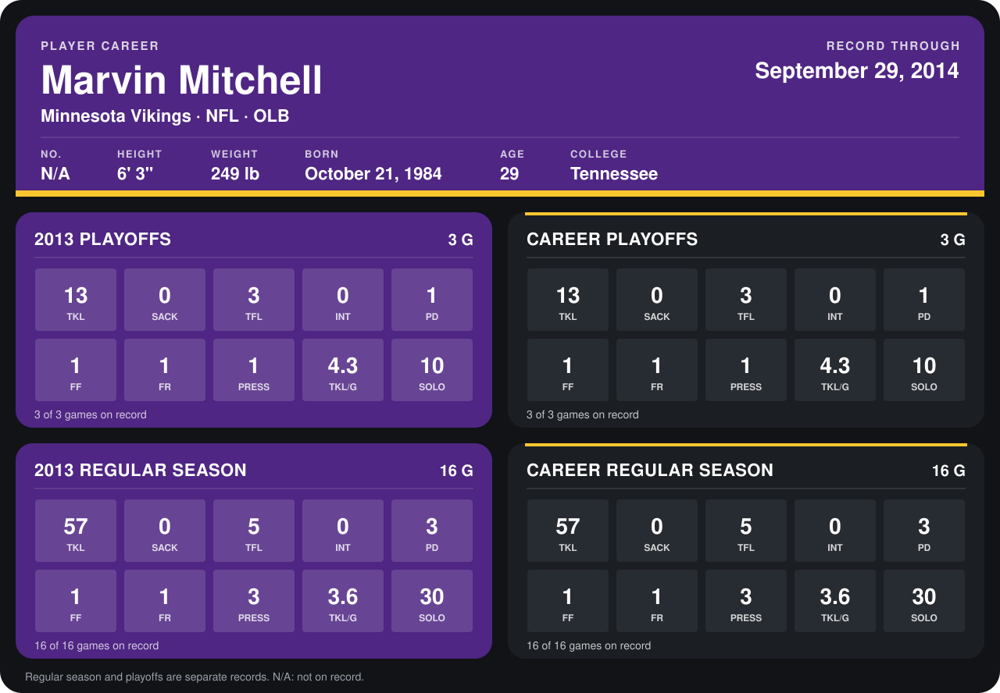

# Marvin Mitchell

## Career stats

### Regular season

| Season | Club | G | TKL | SACK | TFL | INT | PD | FF | FR | PRESS | TKL/G | SOLO |
|---|---|---:|---:|---:|---:|---:|---:|---:|---:|---:|---:|---:|
| 2013 | Minnesota Vikings | 16 | 57 | 0 | 5 | 0 | 3 | 1 | 1 | 3 | 3.6 | 30 |
| **Career** |  | 16 | 57 | 0 | 5 | 0 | 3 | 1 | 1 | 3 | 3.6 | 30 |

### Playoffs

| Season | Club | G | TKL | SACK | TFL | INT | PD | FF | FR | PRESS | TKL/G | SOLO |
|---|---|---:|---:|---:|---:|---:|---:|---:|---:|---:|---:|---:|
| 2013 | Minnesota Vikings | 3 | 13 | 0 | 3 | 0 | 1 | 1 | 1 | 1 | 4.3 | 10 |
| **Career** |  | 3 | 13 | 0 | 3 | 0 | 1 | 1 | 1 | 1 | 4.3 | 10 |

## Awards

None on record.

Records through September 29, 2014. Identity: the public player file's latest listing (no 2014 Weeks 1-4 roster row). [All Minnesota Vikings players](README.md).
