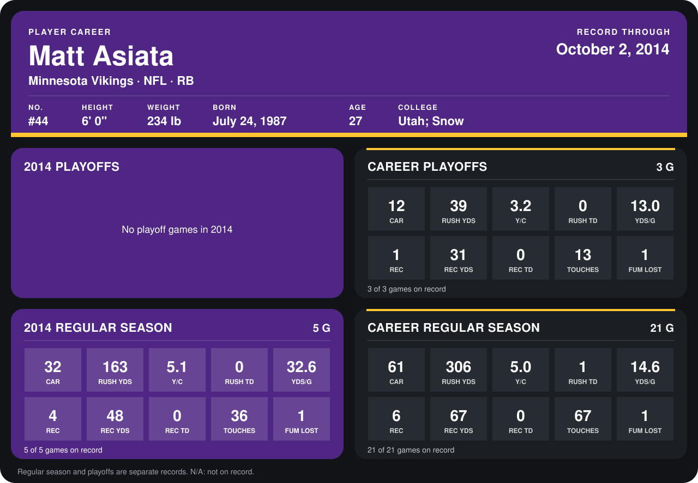

# Matt Asiata

## Career stats

### Regular season

| Season | Club | G | CAR | RUSH YDS | Y/C | RUSH TD | YDS/G | REC | REC YDS | REC TD | TOUCHES | FUM LOST |
|---|---|---:|---:|---:|---:|---:|---:|---:|---:|---:|---:|---:|
| 2013 | Minnesota Vikings | 16 | 29 | 143 | 4.9 | 1 | 8.9 | 2 | 19 | 0 | 31 | 0 |
| 2014 | Minnesota Vikings | 4 | 29 | 145 | 5.0 | 0 | 36.2 | 4 | 48 | 0 | 33 | 1 |
| **Career** |  | 20 | 58 | 288 | 5.0 | 1 | 14.4 | 6 | 67 | 0 | 64 | 1 |

### Playoffs

| Season | Club | G | CAR | RUSH YDS | Y/C | RUSH TD | YDS/G | REC | REC YDS | REC TD | TOUCHES | FUM LOST |
|---|---|---:|---:|---:|---:|---:|---:|---:|---:|---:|---:|---:|
| 2013 | Minnesota Vikings | 3 | 12 | 39 | 3.2 | 0 | 13.0 | 1 | 31 | 0 | 13 | 1 |
| **Career** |  | 3 | 12 | 39 | 3.2 | 0 | 13.0 | 1 | 31 | 0 | 13 | 1 |

## Awards

None on record.

Records through September 29, 2014. Identity: listed 2014 roster data, Weeks 1-4; number: 2014 Week 1 roster. [All Minnesota Vikings players](README.md).
