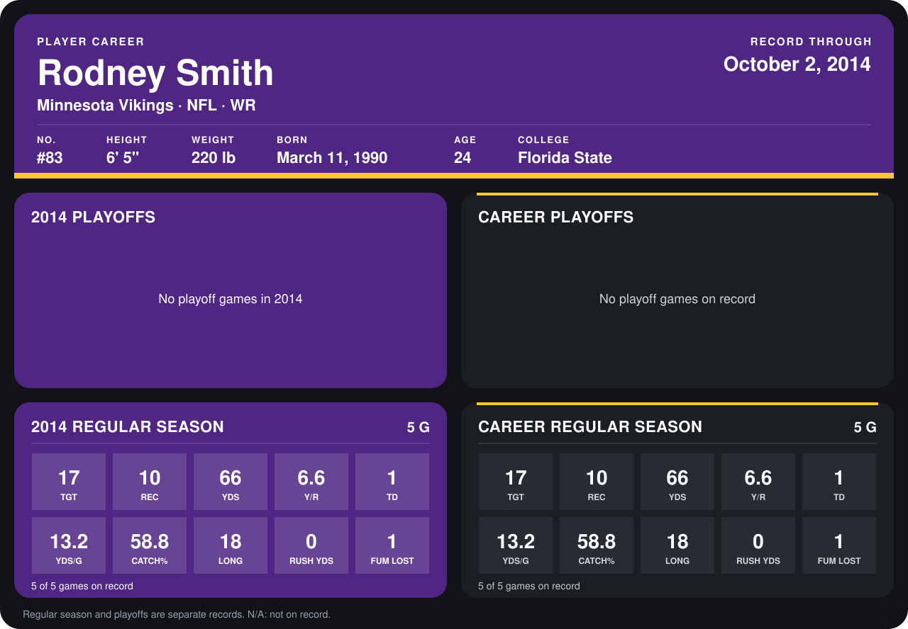

# Rodney Smith

## Career stats

### Regular season

| Season | Club | G | TGT | REC | YDS | Y/R | TD | YDS/G | CATCH% | LONG | RUSH YDS | FUM LOST |
|---|---|---:|---:|---:|---:|---:|---:|---:|---:|---:|---:|---:|
| 2014 | Minnesota Vikings | 5 | 17 | 10 | 66 | 6.6 | 1 | 13.2 | 58.8 | 18 | 0 | 1 |
| **Career** |  | 5 | 17 | 10 | 66 | 6.6 | 1 | 13.2 | 58.8 | 18 | 0 | 1 |

### Playoffs

No playoff games on record.

## Awards

None on record.

Records through October 2, 2014. Identity: listed 2014 roster data, Weeks 1-4; number: 2014 Week 1 roster. [All Minnesota Vikings players](README.md).
