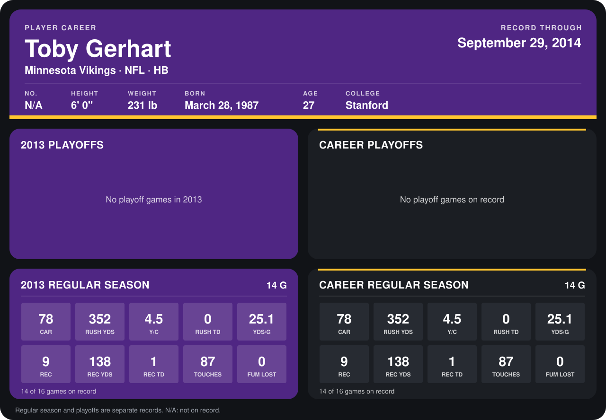

# Toby Gerhart

## Career stats

### Regular season

| Season | Team | Age | # | G | CAR | RUSH YDS | Y/C | RUSH TD | YDS/G | REC | REC YDS | REC TD | TOUCHES | FUM LOST |
|---|---|---:|---:|---:|---:|---:|---:|---:|---:|---:|---:|---:|---:|---:|
| 2013 | Minnesota Vikings | 26 | 32 | 14 | 78 | 352 | 4.5 | 0 | 25.1 | 9 | 138 | 1 | 87 | 0 |
| **Career** |  |  |  | 14 | 78 | 352 | 4.5 | 0 | 25.1 | 9 | 138 | 1 | 87 | 0 |

### Playoffs

No playoff games on record.

## Awards

None on record.

Age is his age on the league's opening game of each season; # is the number listed for him that season with that team (2014: the card's rule; 2013: the 2013 season roster), N/A where no listing applies.

Records through December 29, 2013. Identity: listed 2014 roster data, Weeks 1-4. [All Minnesota Vikings players](README.md).
