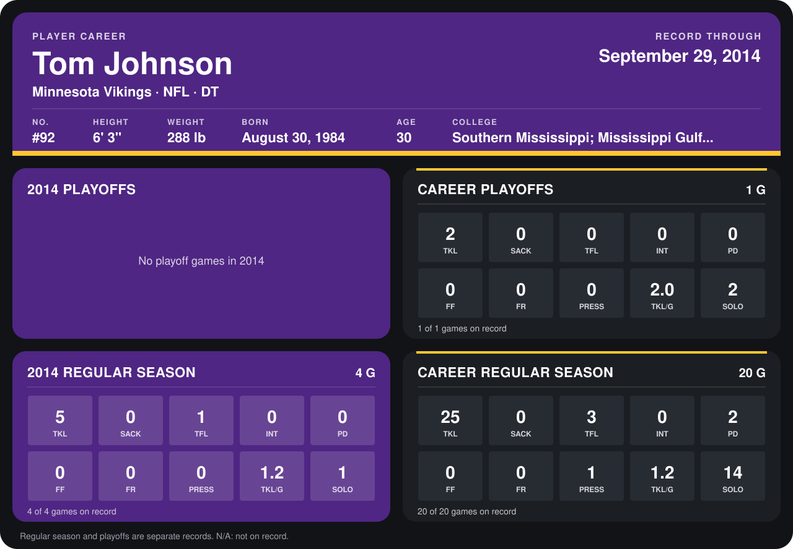

# Tom Johnson

## Career stats

### Regular season

| Season | Club | G | TKL | SACK | TFL | INT | PD | FF | FR | PRESS | TKL/G | SOLO |
|---|---|---:|---:|---:|---:|---:|---:|---:|---:|---:|---:|---:|
| 2013 | New Orleans Saints | 16 | 20 | 0 | 2 | 0 | 2 | 0 | 0 | 1 | 1.2 | 13 |
| 2014 | Minnesota Vikings | 4 | 5 | 0 | 1 | 0 | 0 | 0 | 0 | 0 | 1.2 | 1 |
| **Career** |  | 20 | 25 | 0 | 3 | 0 | 2 | 0 | 0 | 1 | 1.2 | 14 |

### Playoffs

| Season | Club | G | TKL | SACK | TFL | INT | PD | FF | FR | PRESS | TKL/G | SOLO |
|---|---|---:|---:|---:|---:|---:|---:|---:|---:|---:|---:|---:|
| 2013 | New Orleans Saints | 1 | 2 | 0 | 0 | 0 | 0 | 0 | 0 | 0 | 2.0 | 2 |
| **Career** |  | 1 | 2 | 0 | 0 | 0 | 0 | 0 | 0 | 0 | 2.0 | 2 |

## Awards

None on record.

Records through September 29, 2014. Identity: listed 2014 roster data, Weeks 1-4; number: 2014 Week 1 roster. [All Minnesota Vikings players](README.md).
