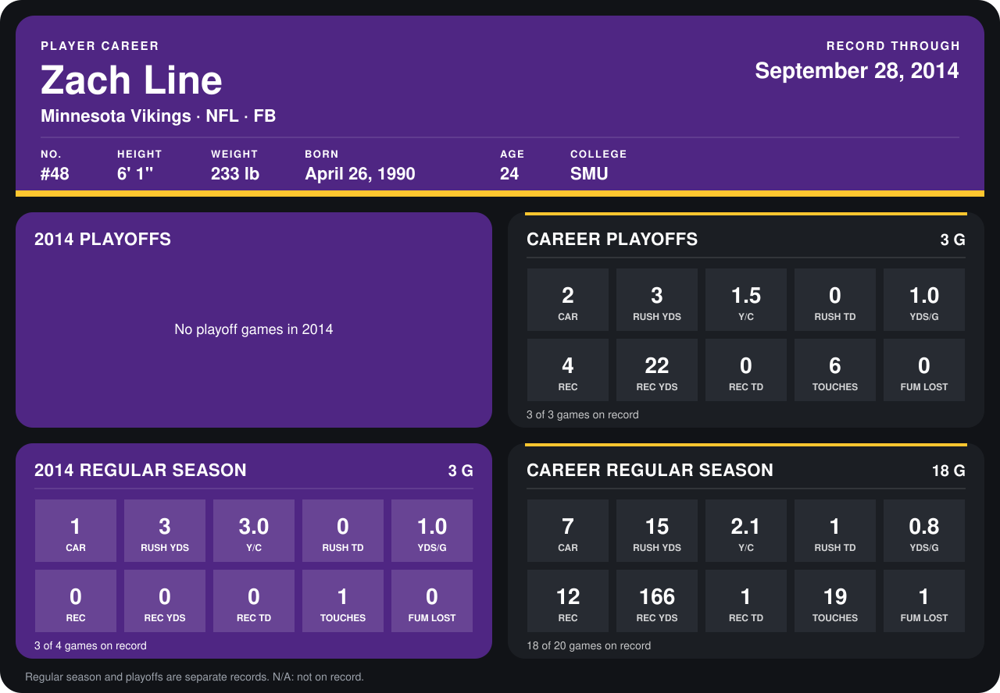

# Zach Line

## Career stats

### Regular season

| Season | Club | G | CAR | RUSH YDS | Y/C | RUSH TD | YDS/G | REC | REC YDS | REC TD | TOUCHES | FUM LOST |
|---|---|---:|---:|---:|---:|---:|---:|---:|---:|---:|---:|---:|
| 2013 | Minnesota Vikings | 15 | 6 | 12 | 2.0 | 1 | 0.8 | 12 | 166 | 1 | 18 | 1 |
| 2014 | Minnesota Vikings | 3 | 1 | 3 | 3.0 | 0 | 1.0 | 0 | 0 | 0 | 1 | 0 |
| **Career** |  | 18 | 7 | 15 | 2.1 | 1 | 0.8 | 12 | 166 | 1 | 19 | 1 |

### Playoffs

| Season | Club | G | CAR | RUSH YDS | Y/C | RUSH TD | YDS/G | REC | REC YDS | REC TD | TOUCHES | FUM LOST |
|---|---|---:|---:|---:|---:|---:|---:|---:|---:|---:|---:|---:|
| 2013 | Minnesota Vikings | 3 | 2 | 3 | 1.5 | 0 | 1.0 | 4 | 22 | 0 | 6 | 0 |
| **Career** |  | 3 | 2 | 3 | 1.5 | 0 | 1.0 | 4 | 22 | 0 | 6 | 0 |

## Awards

- Pro Bowl selection (2013, FB)

Records through October 2, 2014. Identity: listed 2014 roster data, Weeks 1-4; number: 2014 Week 1 roster. [All Minnesota Vikings players](README.md).
