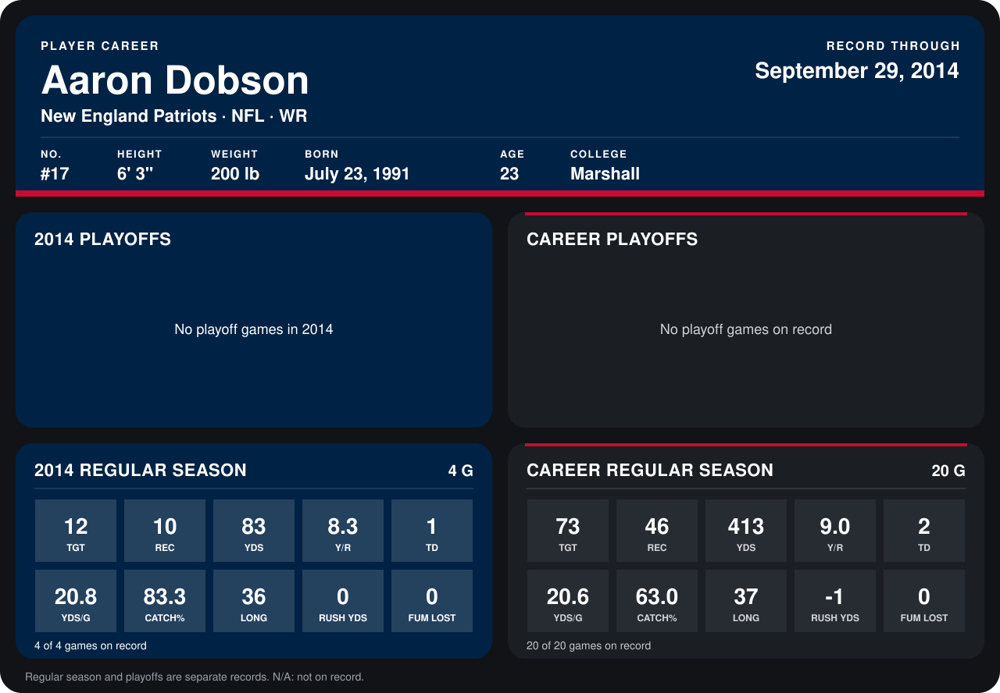

# Aaron Dobson

## Career stats

### Regular season

| Season | Team | Age | # | G | TGT | REC | YDS | Y/R | TD | YDS/G | CATCH% | LONG | RUSH YDS | FUM LOST |
|---|---|---:|---:|---:|---:|---:|---:|---:|---:|---:|---:|---:|---:|---:|
| 2013 | New England Patriots | 22 | 17 | 16 | 61 | 36 | 330 | 9.2 | 1 | 20.6 | 59.0 | 37 | -1 | 0 |
| 2014 | New England Patriots | 23 | 17 | 5 | 13 | 10 | 83 | 8.3 | 1 | 16.6 | 76.9 | 36 | 1 | 0 |
| **Career** |  |  |  | 21 | 74 | 46 | 413 | 9.0 | 2 | 19.7 | 62.2 | 37 | 0 | 0 |

### Playoffs

No playoff games on record.

## Awards

None on record.

Age is his age on the league's opening game of each season; # is the number listed for him that season with that team (2014: the card's rule; 2013: the 2013 season roster), N/A where no listing applies.

Records through October 5, 2014. Identity: listed 2014 roster data, Weeks 1-4; number: 2014 Week 1 roster. [All New England Patriots players](README.md).
