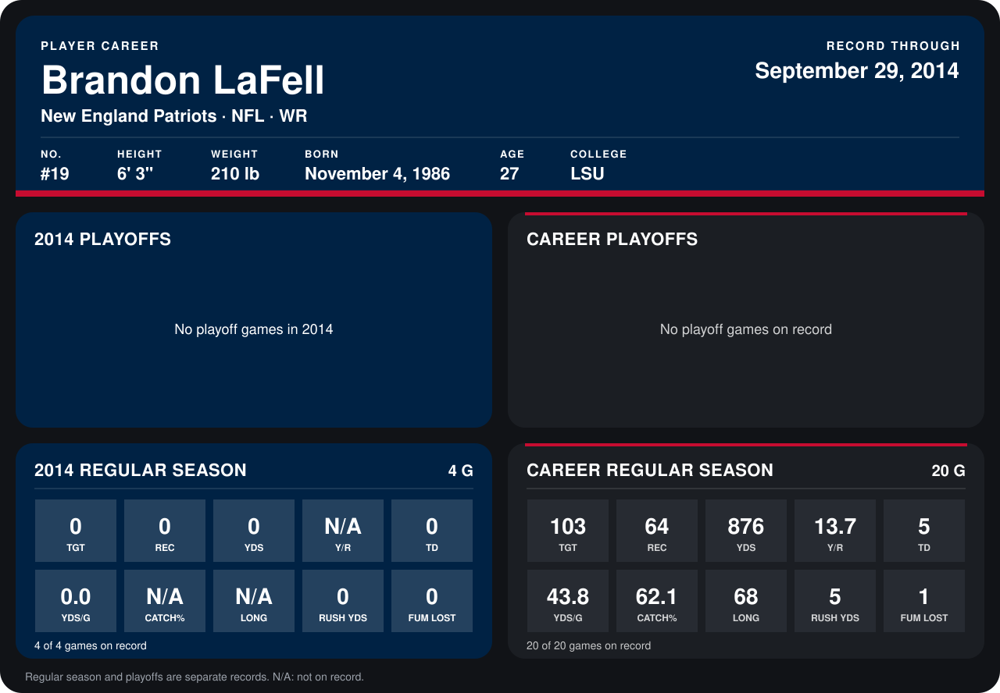

# Brandon LaFell

## Career stats

### Regular season

| Season | Club | G | TGT | REC | YDS | Y/R | TD | YDS/G | CATCH% | LONG | RUSH YDS | FUM LOST |
|---|---|---:|---:|---:|---:|---:|---:|---:|---:|---:|---:|---:|
| 2013 | Carolina Panthers | 16 | 103 | 64 | 876 | 13.7 | 5 | 54.8 | 62.1 | 68 | 5 | 1 |
| 2014 | New England Patriots | 5 | 0 | 0 | 0 | N/A | 0 | 0.0 | N/A | N/A | 0 | 0 |
| **Career** |  | 21 | 103 | 64 | 876 | 13.7 | 5 | 41.7 | 62.1 | 68 | 5 | 1 |

### Playoffs

No playoff games on record.

## Awards

None on record.

Records through October 5, 2014. Identity: listed 2014 roster data, Weeks 1-4; number: 2014 Week 1 roster. [All New England Patriots players](README.md).
