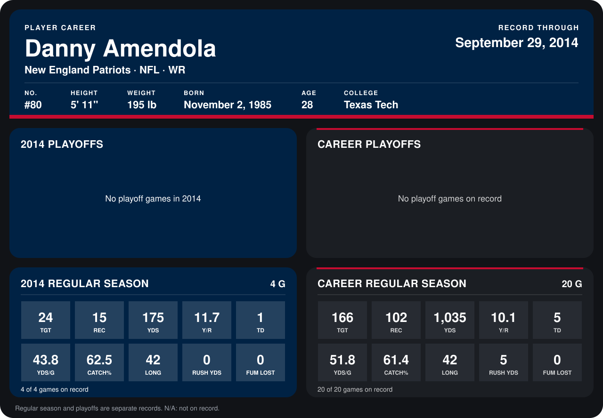

# Danny Amendola

## Career stats

### Regular season

| Season | Club | G | TGT | REC | YDS | Y/R | TD | YDS/G | CATCH% | LONG | RUSH YDS | FUM LOST |
|---|---|---:|---:|---:|---:|---:|---:|---:|---:|---:|---:|---:|
| 2013 | New England Patriots | 16 | 142 | 87 | 860 | 9.9 | 4 | 53.8 | 61.3 | 38 | 5 | 0 |
| 2014 | New England Patriots | 4 | 24 | 15 | 175 | 11.7 | 1 | 43.8 | 62.5 | 42 | 0 | 0 |
| **Career** |  | 20 | 166 | 102 | 1,035 | 10.1 | 5 | 51.8 | 61.4 | 42 | 5 | 0 |

### Playoffs

No playoff games on record.

## Awards

None on record.

Records through September 29, 2014. Identity: listed 2014 roster data, Weeks 1-4; number: 2014 Week 1 roster. [All New England Patriots players](README.md).
