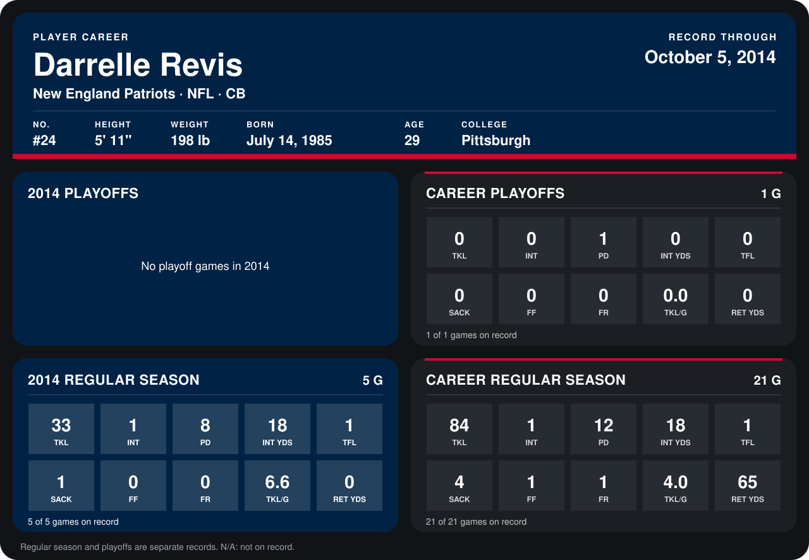

# Darrelle Revis

## Career stats

### Regular season

| Season | Team | Age | # | G | TKL | INT | PD | INT YDS | TFL | SACK | FF | FR | TKL/G | RET YDS |
|---|---|---:|---:|---:|---:|---:|---:|---:|---:|---:|---:|---:|---:|---:|
| 2013 | Tampa Bay Buccaneers | 28 | 24 | 16 | 51 | 0 | 4 | 0 | 0 | 3 | 1 | 1 | 3.2 | 65 |
| 2014 | New England Patriots | 29 | 24 | 5 | 33 | 1 | 8 | 18 | 1 | 1 | 0 | 0 | 6.6 | 0 |
| **Career** |  |  |  | 21 | 84 | 1 | 12 | 18 | 1 | 4 | 1 | 1 | 4.0 | 65 |

### Playoffs

| Season | Team | Age | # | G | TKL | INT | PD | INT YDS | TFL | SACK | FF | FR | TKL/G | RET YDS |
|---|---|---:|---:|---:|---:|---:|---:|---:|---:|---:|---:|---:|---:|---:|
| 2013 | Tampa Bay Buccaneers | 28 | 24 | 1 | 0 | 0 | 1 | 0 | 0 | 0 | 0 | 0 | 0.0 | 0 |
| **Career** |  |  |  | 1 | 0 | 0 | 1 | 0 | 0 | 0 | 0 | 0 | 0.0 | 0 |

## Awards

None on record.

Age is his age on the league's opening game of each season; # is the number listed for him that season with that team (2014: the card's rule; 2013: the 2013 season roster), N/A where no listing applies.

Records through October 5, 2014. Identity: listed 2014 roster data, Weeks 1-4; number: 2014 Week 1 roster. [All New England Patriots players](README.md).
