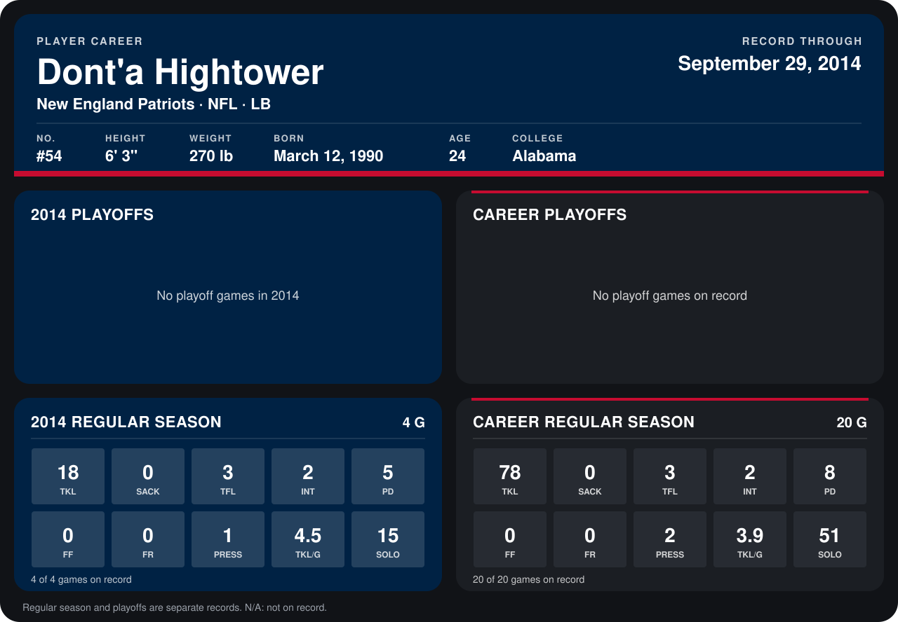

# Dont'a Hightower

## Career stats

### Regular season

| Season | Club | G | TKL | SACK | TFL | INT | PD | FF | FR | PRESS | TKL/G | SOLO |
|---|---|---:|---:|---:|---:|---:|---:|---:|---:|---:|---:|---:|
| 2013 | New England Patriots | 16 | 60 | 0 | 0 | 0 | 3 | 0 | 0 | 1 | 3.8 | 36 |
| 2014 | New England Patriots | 4 | 18 | 0 | 3 | 2 | 5 | 0 | 0 | 1 | 4.5 | 15 |
| **Career** |  | 20 | 78 | 0 | 3 | 2 | 8 | 0 | 0 | 2 | 3.9 | 51 |

### Playoffs

No playoff games on record.

## Awards

None on record.

Records through September 29, 2014. Identity: listed 2014 roster data, Weeks 1-4; number: 2014 Week 1 roster. [All New England Patriots players](README.md).
