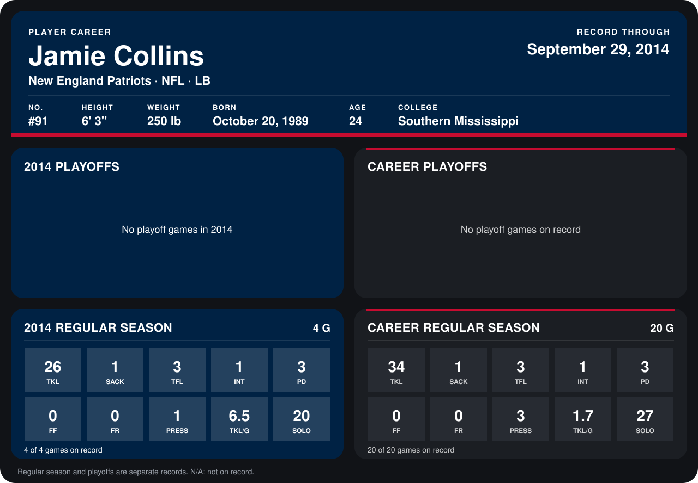

# Jamie Collins

## Career stats

### Regular season

| Season | Team | Age | # | G | TKL | SACK | TFL | INT | PD | FF | FR | PRESS | TKL/G | SOLO |
|---|---|---:|---:|---:|---:|---:|---:|---:|---:|---:|---:|---:|---:|---:|
| 2013 | New England Patriots | 23 | 91 | 16 | 8 | 0 | 0 | 0 | 0 | 0 | 0 | 2 | 0.5 | 7 |
| 2014 | New England Patriots | 24 | 91 | 5 | 36 | 3 | 3 | 1 | 3 | 1 | 1 | 3 | 7.2 | 29 |
| **Career** |  |  |  | 21 | 44 | 3 | 3 | 1 | 3 | 1 | 1 | 5 | 2.1 | 36 |

### Playoffs

No playoff games on record.

## Awards

- AFC Defensive Player of the Week (2014, Week 5)

Age is his age on the league's opening game of each season; # is the number listed for him that season with that team (2014: the card's rule; 2013: the 2013 season roster), N/A where no listing applies.

Records through October 5, 2014. Identity: listed 2014 roster data, Weeks 1-4; number: 2014 Week 1 roster. [All New England Patriots players](README.md).
