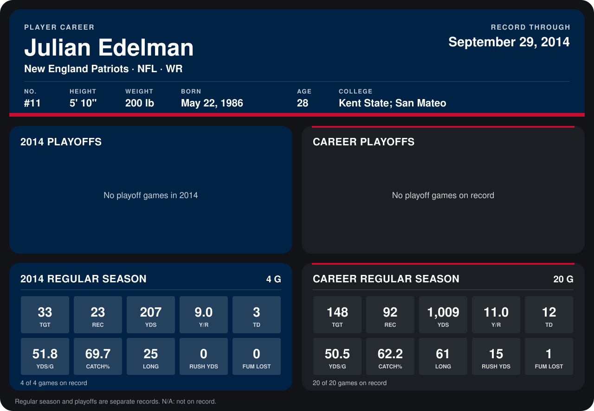

# Julian Edelman

## Career stats

### Regular season

| Season | Club | G | TGT | REC | YDS | Y/R | TD | YDS/G | CATCH% | LONG | RUSH YDS | FUM LOST |
|---|---|---:|---:|---:|---:|---:|---:|---:|---:|---:|---:|---:|
| 2013 | New England Patriots | 16 | 115 | 69 | 802 | 11.6 | 9 | 50.1 | 60.0 | 61 | 15 | 1 |
| 2014 | New England Patriots | 5 | 42 | 29 | 270 | 9.3 | 4 | 54.0 | 69.0 | 25 | 0 | 0 |
| **Career** |  | 21 | 157 | 98 | 1,072 | 10.9 | 13 | 51.0 | 62.4 | 61 | 15 | 1 |

### Playoffs

No playoff games on record.

## Awards

None on record.

Records through October 5, 2014. Identity: listed 2014 roster data, Weeks 1-4; number: 2014 Week 1 roster. [All New England Patriots players](README.md).
