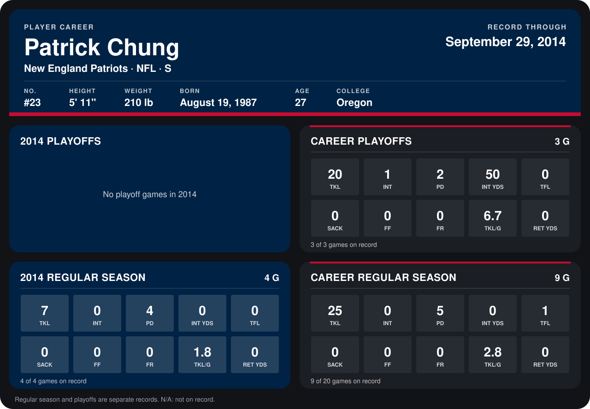

# Patrick Chung

## Career stats

### Regular season

| Season | Club | G | TKL | INT | PD | INT YDS | TFL | SACK | FF | FR | TKL/G | RET YDS |
|---|---|---:|---:|---:|---:|---:|---:|---:|---:|---:|---:|---:|
| 2013 | Philadelphia Eagles | 5 | 18 | 0 | 1 | 0 | 1 | 0 | 0 | 0 | 3.6 | 0 |
| 2014 | New England Patriots | 5 | 7 | 0 | 4 | 0 | 0 | 0 | 0 | 0 | 1.4 | 0 |
| **Career** |  | 10 | 25 | 0 | 5 | 0 | 1 | 0 | 0 | 0 | 2.5 | 0 |

### Playoffs

| Season | Club | G | TKL | INT | PD | INT YDS | TFL | SACK | FF | FR | TKL/G | RET YDS |
|---|---|---:|---:|---:|---:|---:|---:|---:|---:|---:|---:|---:|
| 2013 | Philadelphia Eagles | 3 | 20 | 1 | 2 | 50 | 0 | 0 | 0 | 0 | 6.7 | 0 |
| **Career** |  | 3 | 20 | 1 | 2 | 50 | 0 | 0 | 0 | 0 | 6.7 | 0 |

## Awards

None on record.

Records through October 5, 2014. Identity: listed 2014 roster data, Weeks 1-4; number: 2014 Week 1 roster. [All New England Patriots players](README.md).
