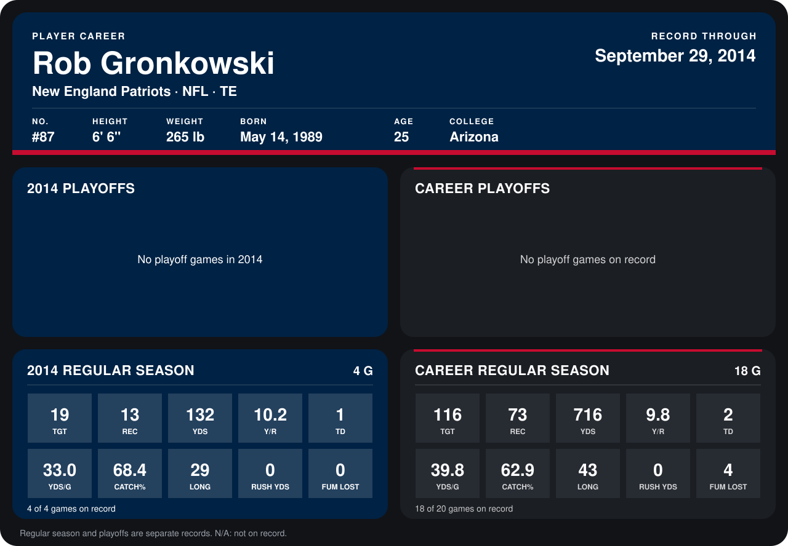

# Rob Gronkowski

## Career stats

### Regular season

| Season | Club | G | TGT | REC | YDS | Y/R | TD | YDS/G | CATCH% | LONG | RUSH YDS | FUM LOST |
|---|---|---:|---:|---:|---:|---:|---:|---:|---:|---:|---:|---:|
| 2013 | New England Patriots | 14 | 97 | 60 | 584 | 9.7 | 1 | 41.7 | 61.9 | 43 | 0 | 4 |
| 2014 | New England Patriots | 4 | 19 | 13 | 132 | 10.2 | 1 | 33.0 | 68.4 | 29 | 0 | 0 |
| **Career** |  | 18 | 116 | 73 | 716 | 9.8 | 2 | 39.8 | 62.9 | 43 | 0 | 4 |

### Playoffs

No playoff games on record.

## Awards

None on record.

Records through September 29, 2014. Identity: listed 2014 roster data, Weeks 1-4; number: 2014 Week 1 roster. [All New England Patriots players](README.md).
