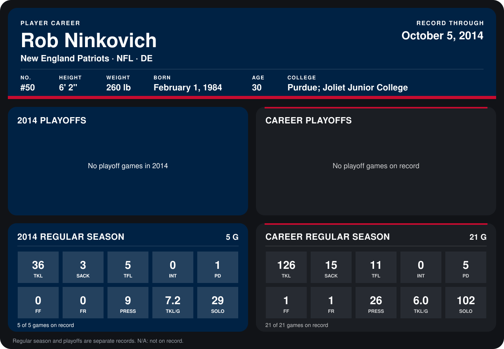

# Rob Ninkovich

## Career stats

### Regular season

| Season | Team | Age | # | G | TKL | SACK | TFL | INT | PD | FF | FR | PRESS | TKL/G | SOLO |
|---|---|---:|---:|---:|---:|---:|---:|---:|---:|---:|---:|---:|---:|---:|
| 2013 | New England Patriots | 29 | 50 | 16 | 90 | 12 | 6 | 0 | 4 | 1 | 1 | 17 | 5.6 | 73 |
| 2014 | New England Patriots | 30 | 50 | 4 | 33 | 3 | 5 | 0 | 1 | 0 | 0 | 8 | 8.2 | 27 |
| **Career** |  |  |  | 20 | 123 | 15 | 11 | 0 | 5 | 1 | 1 | 25 | 6.2 | 100 |

### Playoffs

No playoff games on record.

## Awards

- AP First-Team All-Pro (2013, DE)
- Pro Bowl selection (2013, DE)

Age is his age on the league's opening game of each season; # is the number listed for him that season with that team (2014: the card's rule; 2013: the 2013 season roster), N/A where no listing applies.

Records through September 29, 2014. Identity: listed 2014 roster data, Weeks 1-4; number: 2014 Week 1 roster. [All New England Patriots players](README.md).
