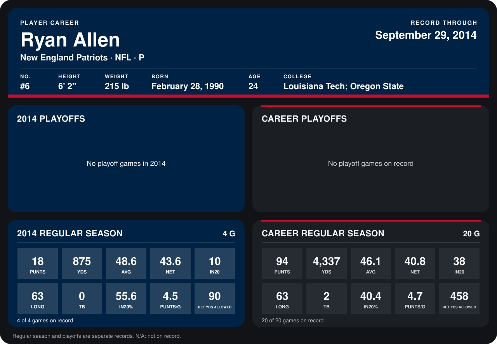

# Ryan Allen

## Career stats

### Regular season

| Season | Team | Age | # | G | PUNTS | YDS | AVG | NET | IN20 | LONG | TB | IN20% | PUNTS/G | RET YDS ALLOWED |
|---|---|---:|---:|---:|---:|---:|---:|---:|---:|---:|---:|---:|---:|---:|
| 2013 | New England Patriots | 23 | 6 | 16 | 76 | 3,462 | 45.6 | 40.2 | 28 | 59 | 2 | 36.8 | 4.8 | 368 |
| 2014 | New England Patriots | 24 | 6 | 4 | 18 | 875 | 48.6 | 43.6 | 10 | 63 | 0 | 55.6 | 4.5 | 90 |
| **Career** |  |  |  | 20 | 94 | 4,337 | 46.1 | 40.8 | 38 | 63 | 2 | 40.4 | 4.7 | 458 |

### Playoffs

No playoff games on record.

## Awards

None on record.

Age is his age on the league's opening game of each season; # is the number listed for him that season with that team (2014: the card's rule; 2013: the 2013 season roster), N/A where no listing applies.

Records through September 29, 2014. Identity: listed 2014 roster data, Weeks 1-4; number: 2014 Week 1 roster. [All New England Patriots players](README.md).
