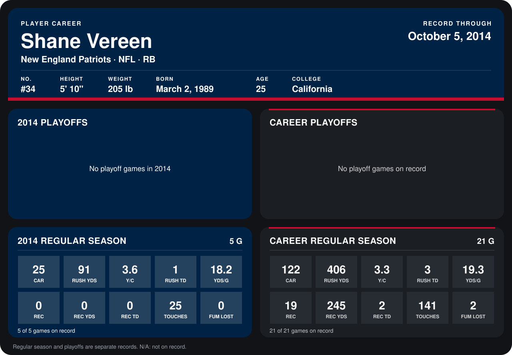

# Shane Vereen

## Career stats

### Regular season

| Season | Team | Age | # | G | CAR | RUSH YDS | Y/C | RUSH TD | YDS/G | REC | REC YDS | REC TD | TOUCHES | FUM LOST |
|---|---|---:|---:|---:|---:|---:|---:|---:|---:|---:|---:|---:|---:|---:|
| 2013 | New England Patriots | 24 | 34 | 16 | 97 | 315 | 3.2 | 2 | 19.7 | 19 | 245 | 2 | 116 | 2 |
| 2014 | New England Patriots | 25 | 34 | 5 | 25 | 91 | 3.6 | 1 | 18.2 | 0 | 0 | 0 | 25 | 0 |
| **Career** |  |  |  | 21 | 122 | 406 | 3.3 | 3 | 19.3 | 19 | 245 | 2 | 141 | 2 |

### Playoffs

No playoff games on record.

## Awards

None on record.

Age is his age on the league's opening game of each season; # is the number listed for him that season with that team (2014: the card's rule; 2013: the 2013 season roster), N/A where no listing applies.

Records through October 5, 2014. Identity: listed 2014 roster data, Weeks 1-4; number: 2014 Week 1 roster. [All New England Patriots players](README.md).
