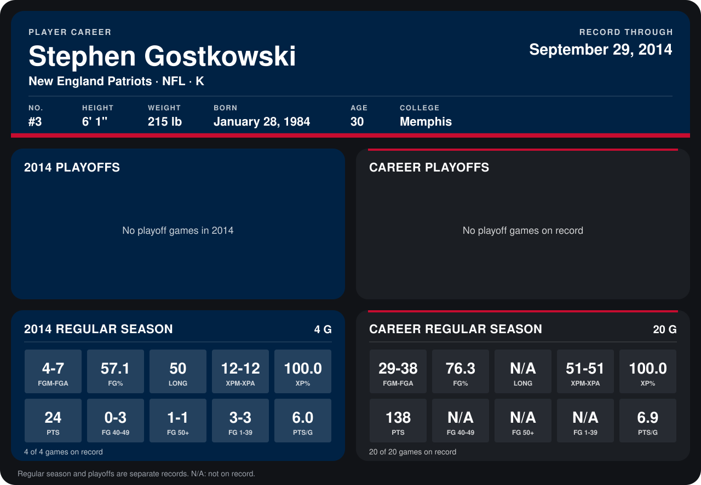

# Stephen Gostkowski

## Career stats

### Regular season

| Season | Team | Age | # | G | FGM-FGA | FG% | LONG | XPM-XPA | XP% | PTS | FG 40-49 | FG 50+ | FG 1-39 | PTS/G |
|---|---|---:|---:|---:|---:|---:|---:|---:|---:|---:|---:|---:|---:|---:|
| 2013 | New England Patriots | 29 | 3 | 16 | 25-31 | 80.6 | N/A | 39-39 | 100.0 | 114 | N/A | N/A | N/A | 7.1 |
| 2014 | New England Patriots | 30 | 3 | 4 | 4-7 | 57.1 | 50 | 12-12 | 100.0 | 24 | 0-3 | 1-1 | 3-3 | 6.0 |
| **Career** |  |  |  | 20 | 29-38 | 76.3 | N/A | 51-51 | 100.0 | 138 | N/A | N/A | N/A | 6.9 |

### Playoffs

No playoff games on record.

## Awards

None on record.

Age is his age on the league's opening game of each season; # is the number listed for him that season with that team (2014: the card's rule; 2013: the 2013 season roster), N/A where no listing applies.

Records through September 29, 2014. Identity: listed 2014 roster data, Weeks 1-4; number: 2014 Week 1 roster. [All New England Patriots players](README.md).
