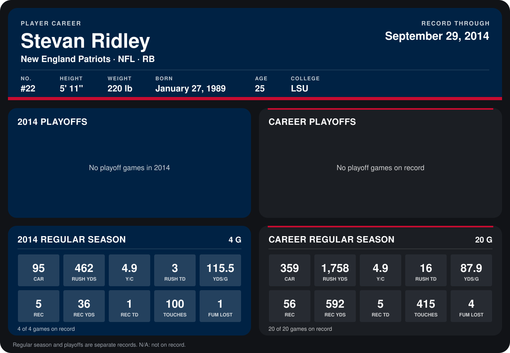

# Stevan Ridley

## Career stats

### Regular season

| Season | Club | G | CAR | RUSH YDS | Y/C | RUSH TD | YDS/G | REC | REC YDS | REC TD | TOUCHES | FUM LOST |
|---|---|---:|---:|---:|---:|---:|---:|---:|---:|---:|---:|---:|
| 2013 | New England Patriots | 16 | 264 | 1,296 | 4.9 | 13 | 81.0 | 51 | 556 | 4 | 315 | 3 |
| 2014 | New England Patriots | 5 | 112 | 502 | 4.5 | 5 | 100.4 | 7 | 52 | 1 | 119 | 1 |
| **Career** |  | 21 | 376 | 1,798 | 4.8 | 18 | 85.6 | 58 | 608 | 5 | 434 | 4 |

### Playoffs

No playoff games on record.

## Awards

- AFC Offensive Player of the Week (2013, Week 6)
- AFC Offensive Player of the Week (2013, Week 9)
- AFC Offensive Player of the Month (2013, November)
- Pro Bowl selection (2013, RB)

Records through October 5, 2014. Identity: listed 2014 roster data, Weeks 1-4; number: 2014 Week 1 roster. [All New England Patriots players](README.md).
