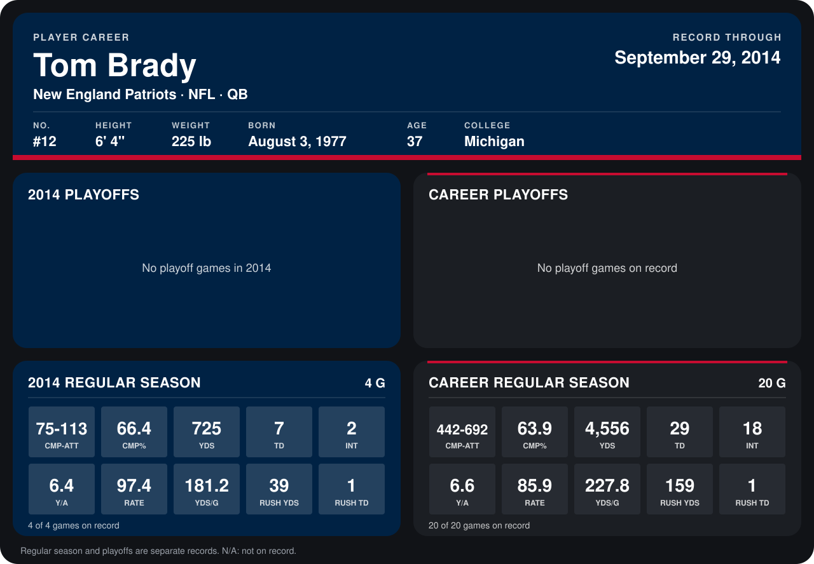

# Tom Brady

## Career stats

### Regular season

| Season | Club | G | CMP-ATT | CMP% | YDS | TD | INT | Y/A | RATE | YDS/G | RUSH YDS | RUSH TD |
|---|---|---:|---:|---:|---:|---:|---:|---:|---:|---:|---:|---:|
| 2013 | New England Patriots | 16 | 367-579 | 63.4 | 3,831 | 22 | 16 | 6.6 | 83.6 | 239.4 | 120 | 0 |
| 2014 | New England Patriots | 5 | 96-141 | 68.1 | 1,053 | 10 | 3 | 7.5 | 104.7 | 210.6 | 38 | 1 |
| **Career** |  | 21 | 463-720 | 64.3 | 4,884 | 32 | 19 | 6.8 | 87.8 | 232.6 | 158 | 1 |

### Playoffs

No playoff games on record.

## Awards

- AFC Offensive Player of the Week (2013, Week 17)

Records through October 5, 2014. Identity: listed 2014 roster data, Weeks 1-4; number: 2014 Week 1 roster. [All New England Patriots players](README.md).
