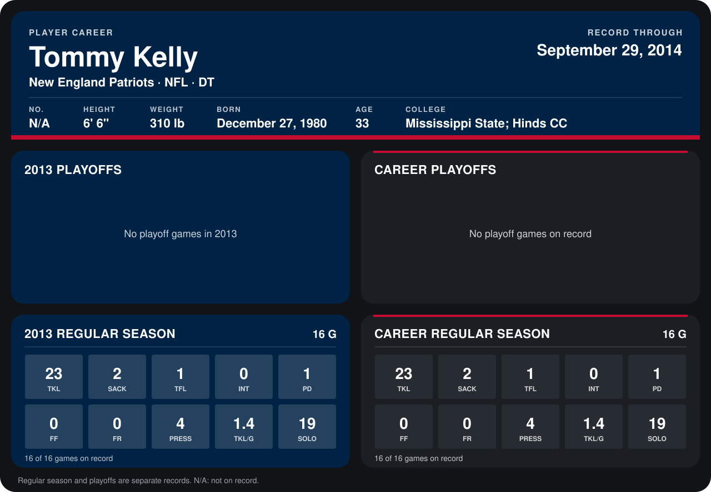

# Tommy Kelly

## Career stats

### Regular season

| Season | Team | Age | # | G | TKL | SACK | TFL | INT | PD | FF | FR | PRESS | TKL/G | SOLO |
|---|---|---:|---:|---:|---:|---:|---:|---:|---:|---:|---:|---:|---:|---:|
| 2013 | New England Patriots | 32 | 93 | 16 | 23 | 2 | 1 | 0 | 1 | 0 | 0 | 4 | 1.4 | 19 |
| **Career** |  |  |  | 16 | 23 | 2 | 1 | 0 | 1 | 0 | 0 | 4 | 1.4 | 19 |

### Playoffs

No playoff games on record.

## Awards

None on record.

Age is his age on the league's opening game of each season; # is the number listed for him that season with that team (2014: the card's rule; 2013: the 2013 season roster), N/A where no listing applies.

Records through December 29, 2013. Identity: listed 2014 roster data, Weeks 1-4. [All New England Patriots players](README.md).
