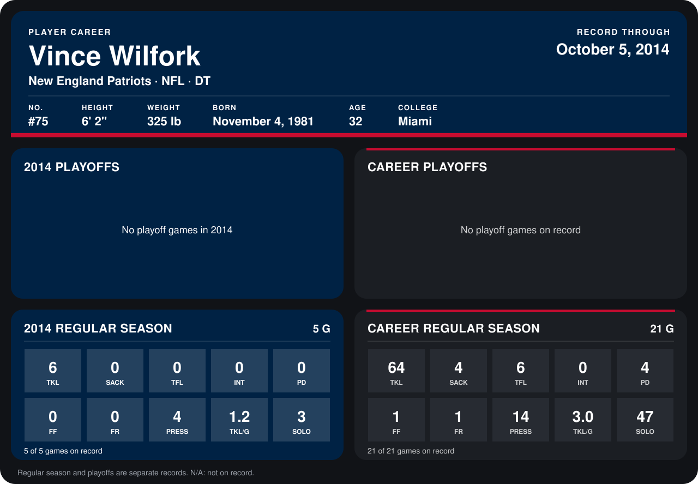

# Vince Wilfork

## Career stats

### Regular season

| Season | Club | G | TKL | SACK | TFL | INT | PD | FF | FR | PRESS | TKL/G | SOLO |
|---|---|---:|---:|---:|---:|---:|---:|---:|---:|---:|---:|---:|
| 2013 | New England Patriots | 16 | 58 | 4 | 6 | 0 | 4 | 1 | 1 | 10 | 3.6 | 44 |
| 2014 | New England Patriots | 5 | 6 | 0 | 0 | 0 | 0 | 0 | 0 | 4 | 1.2 | 3 |
| **Career** |  | 21 | 64 | 4 | 6 | 0 | 4 | 1 | 1 | 14 | 3.0 | 47 |

### Playoffs

No playoff games on record.

## Awards

None on record.

Records through October 5, 2014. Identity: listed 2014 roster data, Weeks 1-4; number: 2014 Week 1 roster. [All New England Patriots players](README.md).
