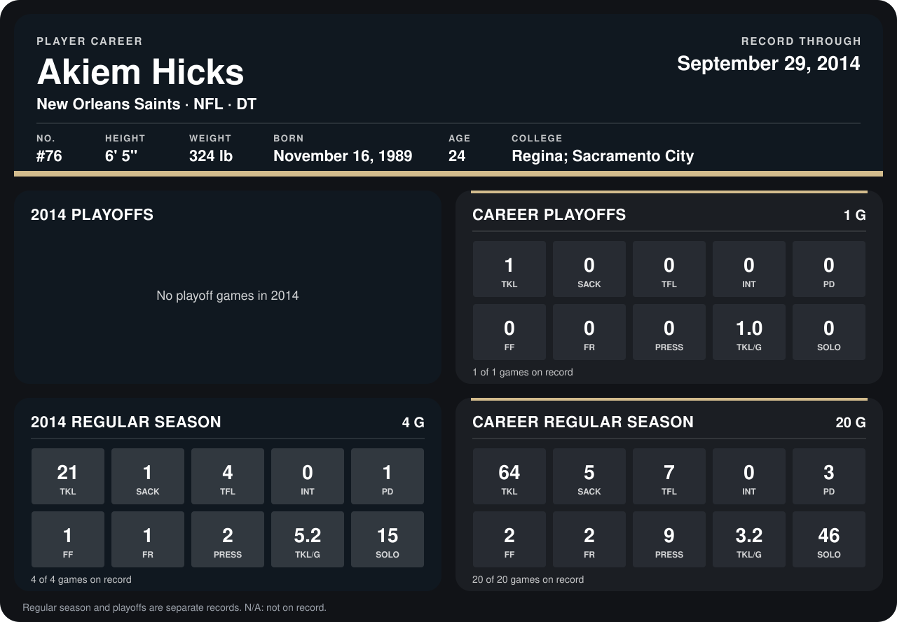

# Akiem Hicks

## Career stats

### Regular season

| Season | Club | G | TKL | SACK | TFL | INT | PD | FF | FR | PRESS | TKL/G | SOLO |
|---|---|---:|---:|---:|---:|---:|---:|---:|---:|---:|---:|---:|
| 2013 | New Orleans Saints | 16 | 43 | 4 | 3 | 0 | 2 | 1 | 1 | 7 | 2.7 | 31 |
| 2014 | New Orleans Saints | 4 | 21 | 1 | 4 | 0 | 1 | 1 | 1 | 2 | 5.2 | 15 |
| **Career** |  | 20 | 64 | 5 | 7 | 0 | 3 | 2 | 2 | 9 | 3.2 | 46 |

### Playoffs

| Season | Club | G | TKL | SACK | TFL | INT | PD | FF | FR | PRESS | TKL/G | SOLO |
|---|---|---:|---:|---:|---:|---:|---:|---:|---:|---:|---:|---:|
| 2013 | New Orleans Saints | 1 | 1 | 0 | 0 | 0 | 0 | 0 | 0 | 0 | 1.0 | 0 |
| **Career** |  | 1 | 1 | 0 | 0 | 0 | 0 | 0 | 0 | 0 | 1.0 | 0 |

## Awards

None on record.

Records through September 29, 2014. Identity: listed 2014 roster data, Weeks 1-4; number: 2014 Week 1 roster. [All New Orleans Saints players](README.md).
