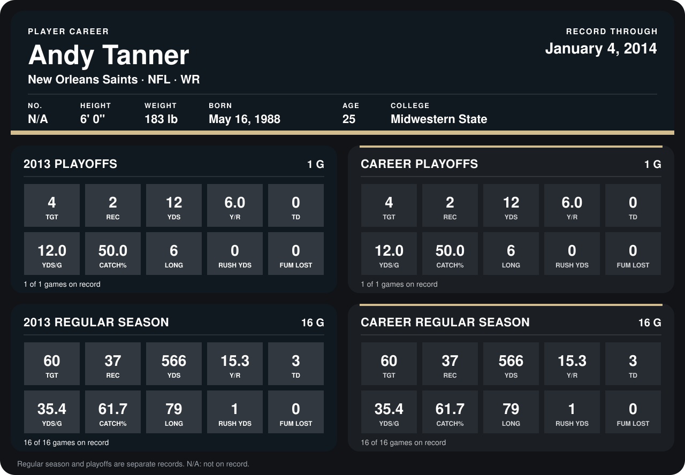

# Andy Tanner

## Career stats

### Regular season

| Season | Club | G | TGT | REC | YDS | Y/R | TD | YDS/G | CATCH% | LONG | RUSH YDS | FUM LOST |
|---|---|---:|---:|---:|---:|---:|---:|---:|---:|---:|---:|---:|
| 2013 | New Orleans Saints | 16 | 60 | 37 | 566 | 15.3 | 3 | 35.4 | 61.7 | 79 | 1 | 0 |
| **Career** |  | 16 | 60 | 37 | 566 | 15.3 | 3 | 35.4 | 61.7 | 79 | 1 | 0 |

### Playoffs

| Season | Club | G | TGT | REC | YDS | Y/R | TD | YDS/G | CATCH% | LONG | RUSH YDS | FUM LOST |
|---|---|---:|---:|---:|---:|---:|---:|---:|---:|---:|---:|---:|
| 2013 | New Orleans Saints | 1 | 4 | 2 | 12 | 6.0 | 0 | 12.0 | 50.0 | 6 | 0 | 0 |
| **Career** |  | 1 | 4 | 2 | 12 | 6.0 | 0 | 12.0 | 50.0 | 6 | 0 | 0 |

## Awards

None on record.

Records through September 29, 2014. Identity: the public player file's latest listing (no 2014 Weeks 1-4 roster row). [All New Orleans Saints players](README.md).
