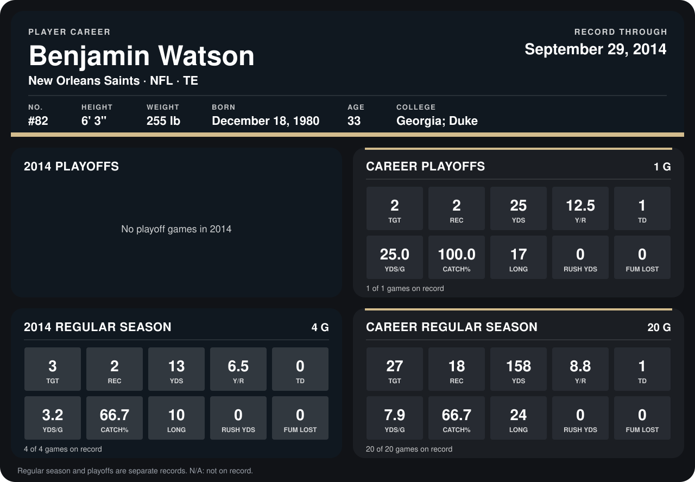

# Benjamin Watson

## Career stats

### Regular season

| Season | Team | Age | # | G | TGT | REC | YDS | Y/R | TD | YDS/G | CATCH% | LONG | RUSH YDS | FUM LOST |
|---|---|---:|---:|---:|---:|---:|---:|---:|---:|---:|---:|---:|---:|---:|
| 2013 | New Orleans Saints | 32 | 82 | 16 | 24 | 16 | 145 | 9.1 | 1 | 9.1 | 66.7 | 24 | 0 | 0 |
| 2014 | New Orleans Saints | 33 | 82 | 5 | 3 | 2 | 13 | 6.5 | 0 | 2.6 | 66.7 | 10 | 0 | 0 |
| **Career** |  |  |  | 21 | 27 | 18 | 158 | 8.8 | 1 | 7.5 | 66.7 | 24 | 0 | 0 |

### Playoffs

| Season | Team | Age | # | G | TGT | REC | YDS | Y/R | TD | YDS/G | CATCH% | LONG | RUSH YDS | FUM LOST |
|---|---|---:|---:|---:|---:|---:|---:|---:|---:|---:|---:|---:|---:|---:|
| 2013 | New Orleans Saints | 32 | 82 | 1 | 2 | 2 | 25 | 12.5 | 1 | 25.0 | 100.0 | 17 | 0 | 0 |
| **Career** |  |  |  | 1 | 2 | 2 | 25 | 12.5 | 1 | 25.0 | 100.0 | 17 | 0 | 0 |

## Awards

None on record.

Age is his age on the league's opening game of each season; # is the number listed for him that season with that team (2014: the card's rule; 2013: the 2013 season roster), N/A where no listing applies.

Records through October 5, 2014. Identity: listed 2014 roster data, Weeks 1-4; number: 2014 Week 1 roster. [All New Orleans Saints players](README.md).
