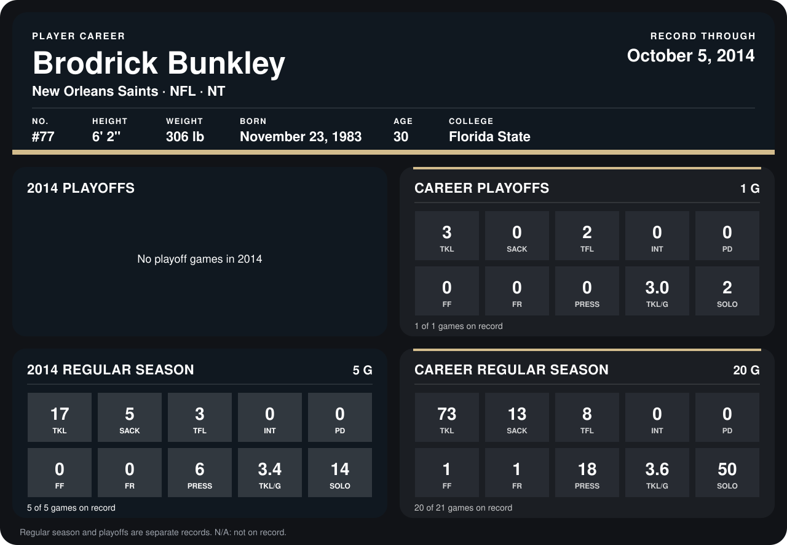

# Brodrick Bunkley

## Career stats

### Regular season

| Season | Club | G | TKL | SACK | TFL | INT | PD | FF | FR | PRESS | TKL/G | SOLO |
|---|---|---:|---:|---:|---:|---:|---:|---:|---:|---:|---:|---:|
| 2013 | New Orleans Saints | 15 | 56 | 8 | 5 | 0 | 0 | 1 | 1 | 12 | 3.7 | 36 |
| 2014 | New Orleans Saints | 5 | 17 | 5 | 3 | 0 | 0 | 0 | 0 | 6 | 3.4 | 14 |
| **Career** |  | 20 | 73 | 13 | 8 | 0 | 0 | 1 | 1 | 18 | 3.6 | 50 |

### Playoffs

| Season | Club | G | TKL | SACK | TFL | INT | PD | FF | FR | PRESS | TKL/G | SOLO |
|---|---|---:|---:|---:|---:|---:|---:|---:|---:|---:|---:|---:|
| 2013 | New Orleans Saints | 1 | 3 | 0 | 2 | 0 | 0 | 0 | 0 | 0 | 3.0 | 2 |
| **Career** |  | 1 | 3 | 0 | 2 | 0 | 0 | 0 | 0 | 0 | 3.0 | 2 |

## Awards

None on record.

Records through October 5, 2014. Identity: listed 2014 roster data, Weeks 1-4; number: 2014 Week 1 roster. [All New Orleans Saints players](README.md).
