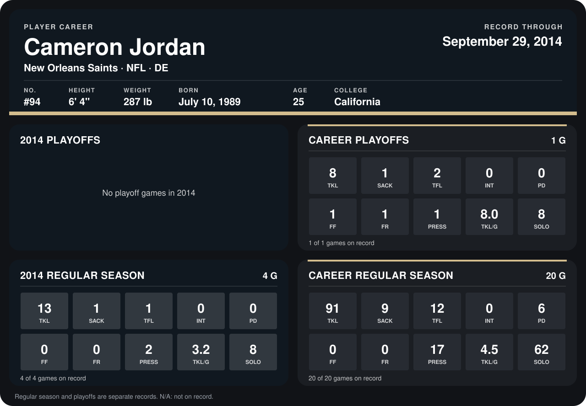

# Cameron Jordan

## Career stats

### Regular season

| Season | Club | G | TKL | SACK | TFL | INT | PD | FF | FR | PRESS | TKL/G | SOLO |
|---|---|---:|---:|---:|---:|---:|---:|---:|---:|---:|---:|---:|
| 2013 | New Orleans Saints | 16 | 78 | 8 | 11 | 0 | 6 | 0 | 0 | 15 | 4.9 | 54 |
| 2014 | New Orleans Saints | 5 | 17 | 1 | 1 | 0 | 1 | 0 | 0 | 2 | 3.4 | 11 |
| **Career** |  | 21 | 95 | 9 | 12 | 0 | 7 | 0 | 0 | 17 | 4.5 | 65 |

### Playoffs

| Season | Club | G | TKL | SACK | TFL | INT | PD | FF | FR | PRESS | TKL/G | SOLO |
|---|---|---:|---:|---:|---:|---:|---:|---:|---:|---:|---:|---:|
| 2013 | New Orleans Saints | 1 | 8 | 1 | 2 | 0 | 0 | 1 | 1 | 1 | 8.0 | 8 |
| **Career** |  | 1 | 8 | 1 | 2 | 0 | 0 | 1 | 1 | 1 | 8.0 | 8 |

## Awards

None on record.

Records through October 5, 2014. Identity: listed 2014 roster data, Weeks 1-4; number: 2014 Week 1 roster. [All New Orleans Saints players](README.md).
