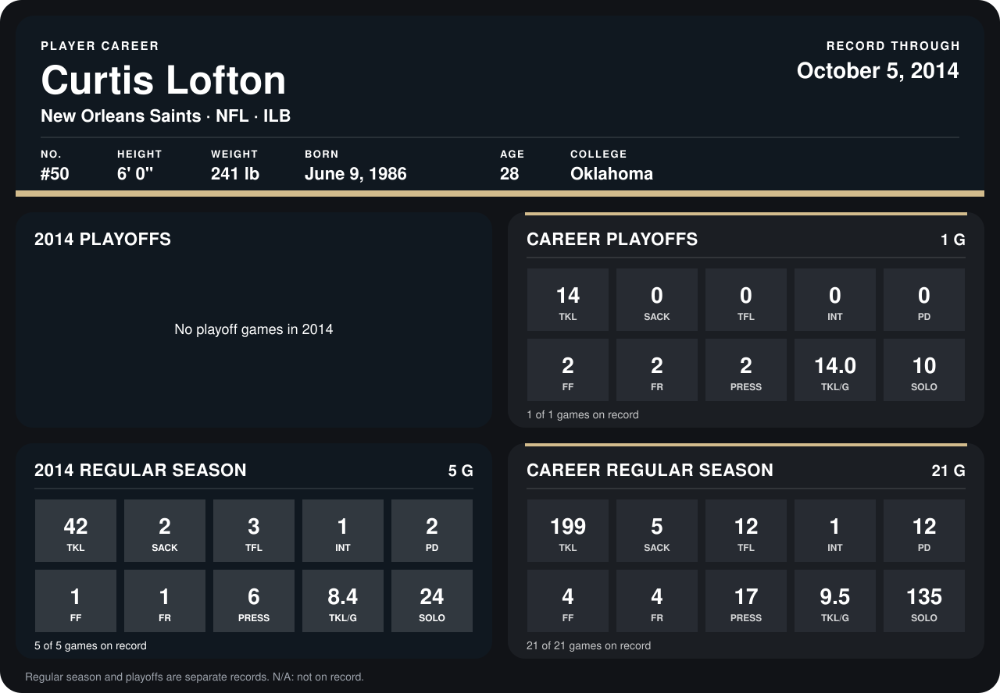

# Curtis Lofton

## Career stats

### Regular season

| Season | Club | G | TKL | SACK | TFL | INT | PD | FF | FR | PRESS | TKL/G | SOLO |
|---|---|---:|---:|---:|---:|---:|---:|---:|---:|---:|---:|---:|
| 2013 | New Orleans Saints | 16 | 157 | 3 | 9 | 0 | 10 | 3 | 3 | 11 | 9.8 | 111 |
| 2014 | New Orleans Saints | 5 | 42 | 2 | 3 | 1 | 2 | 1 | 1 | 6 | 8.4 | 24 |
| **Career** |  | 21 | 199 | 5 | 12 | 1 | 12 | 4 | 4 | 17 | 9.5 | 135 |

### Playoffs

| Season | Club | G | TKL | SACK | TFL | INT | PD | FF | FR | PRESS | TKL/G | SOLO |
|---|---|---:|---:|---:|---:|---:|---:|---:|---:|---:|---:|---:|
| 2013 | New Orleans Saints | 1 | 14 | 0 | 0 | 0 | 0 | 2 | 2 | 2 | 14.0 | 10 |
| **Career** |  | 1 | 14 | 0 | 0 | 0 | 0 | 2 | 2 | 2 | 14.0 | 10 |

## Awards

- NFC Defensive Player of the Week (2013, Week 14)
- Pro Bowl selection (2013, ILB)

Records through October 5, 2014. Identity: listed 2014 roster data, Weeks 1-4; number: 2014 Week 1 roster. [All New Orleans Saints players](README.md).
