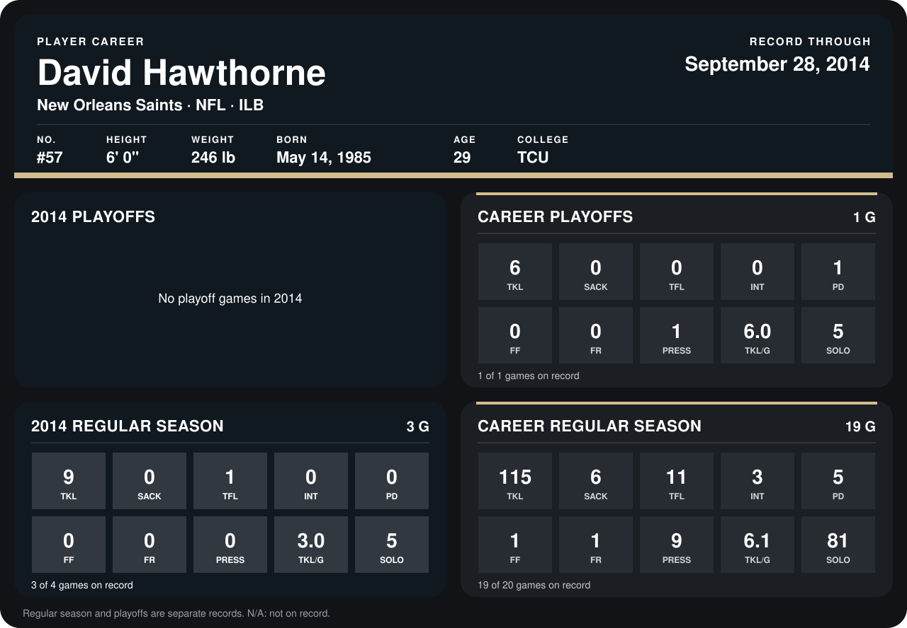

# David Hawthorne

## Career stats

### Regular season

| Season | Team | Age | # | G | TKL | SACK | TFL | INT | PD | FF | FR | PRESS | TKL/G | SOLO |
|---|---|---:|---:|---:|---:|---:|---:|---:|---:|---:|---:|---:|---:|---:|
| 2013 | New Orleans Saints | 28 | 57 | 16 | 106 | 6 | 10 | 3 | 5 | 1 | 1 | 9 | 6.6 | 76 |
| 2014 | New Orleans Saints | 29 | 57 | 4 | 17 | 1 | 1 | 0 | 1 | 0 | 0 | 2 | 4.2 | 13 |
| **Career** |  |  |  | 20 | 123 | 7 | 11 | 3 | 6 | 1 | 1 | 11 | 6.2 | 89 |

### Playoffs

| Season | Team | Age | # | G | TKL | SACK | TFL | INT | PD | FF | FR | PRESS | TKL/G | SOLO |
|---|---|---:|---:|---:|---:|---:|---:|---:|---:|---:|---:|---:|---:|---:|
| 2013 | New Orleans Saints | 28 | 57 | 1 | 6 | 0 | 0 | 0 | 1 | 0 | 0 | 1 | 6.0 | 5 |
| **Career** |  |  |  | 1 | 6 | 0 | 0 | 0 | 1 | 0 | 0 | 1 | 6.0 | 5 |

## Awards

None on record.

Age is his age on the league's opening game of each season; # is the number listed for him that season with that team (2014: the card's rule; 2013: the 2013 season roster), N/A where no listing applies.

Records through October 5, 2014. Identity: listed 2014 roster data, Weeks 1-4; number: 2014 Week 1 roster. [All New Orleans Saints players](README.md).
