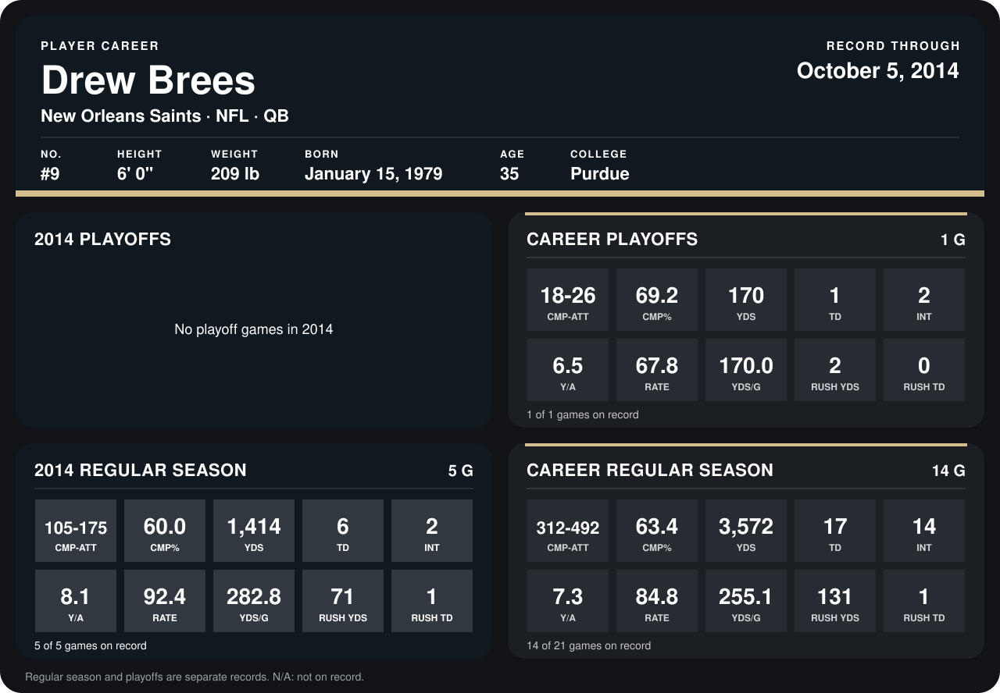

# Drew Brees

## Career stats

### Regular season

| Season | Club | G | CMP-ATT | CMP% | YDS | TD | INT | Y/A | RATE | YDS/G | RUSH YDS | RUSH TD |
|---|---|---:|---:|---:|---:|---:|---:|---:|---:|---:|---:|---:|
| 2013 | New Orleans Saints | 9 | 207-317 | 65.3 | 2,158 | 11 | 12 | 6.8 | 80.7 | 239.8 | 60 | 0 |
| 2014 | New Orleans Saints | 5 | 105-175 | 60.0 | 1,414 | 6 | 2 | 8.1 | 92.4 | 282.8 | 71 | 1 |
| **Career** |  | 14 | 312-492 | 63.4 | 3,572 | 17 | 14 | 7.3 | 84.8 | 255.1 | 131 | 1 |

### Playoffs

| Season | Club | G | CMP-ATT | CMP% | YDS | TD | INT | Y/A | RATE | YDS/G | RUSH YDS | RUSH TD |
|---|---|---:|---:|---:|---:|---:|---:|---:|---:|---:|---:|---:|
| 2013 | New Orleans Saints | 1 | 18-26 | 69.2 | 170 | 1 | 2 | 6.5 | 67.8 | 170.0 | 2 | 0 |
| **Career** |  | 1 | 18-26 | 69.2 | 170 | 1 | 2 | 6.5 | 67.8 | 170.0 | 2 | 0 |

## Awards

None on record.

Records through October 5, 2014. Identity: listed 2014 roster data, Weeks 1-4; number: 2014 Week 1 roster. [All New Orleans Saints players](README.md).
