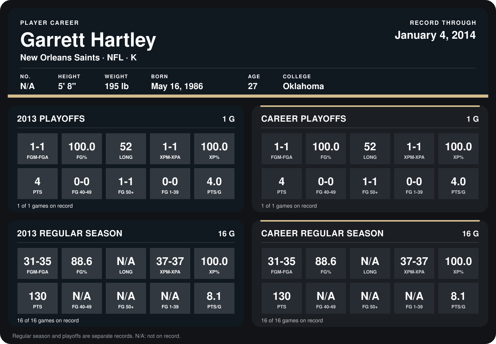

# Garrett Hartley

## Career stats

### Regular season

| Season | Team | Age | # | G | FGM-FGA | FG% | LONG | XPM-XPA | XP% | PTS | FG 40-49 | FG 50+ | FG 1-39 | PTS/G |
|---|---|---:|---:|---:|---:|---:|---:|---:|---:|---:|---:|---:|---:|---:|
| 2013 | New Orleans Saints | 27 | 5 | 16 | 31-35 | 88.6 | N/A | 37-37 | 100.0 | 130 | N/A | N/A | N/A | 8.1 |
| **Career** |  |  |  | 16 | 31-35 | 88.6 | N/A | 37-37 | 100.0 | 130 | N/A | N/A | N/A | 8.1 |

### Playoffs

| Season | Team | Age | # | G | FGM-FGA | FG% | LONG | XPM-XPA | XP% | PTS | FG 40-49 | FG 50+ | FG 1-39 | PTS/G |
|---|---|---:|---:|---:|---:|---:|---:|---:|---:|---:|---:|---:|---:|---:|
| 2013 | New Orleans Saints | 27 | 5 | 1 | 1-1 | 100.0 | 52 | 1-1 | 100.0 | 4 | 0-0 | 1-1 | 0-0 | 4.0 |
| **Career** |  |  |  | 1 | 1-1 | 100.0 | 52 | 1-1 | 100.0 | 4 | 0-0 | 1-1 | 0-0 | 4.0 |

## Awards

None on record.

Age is his age on the league's opening game of each season; # is the number listed for him that season with that team (2014: the card's rule; 2013: the 2013 season roster), N/A where no listing applies.

Records through January 4, 2014. Identity: his listed 2013 season roster data (no 2014 Weeks 1-4 roster row). [All New Orleans Saints players](README.md).
