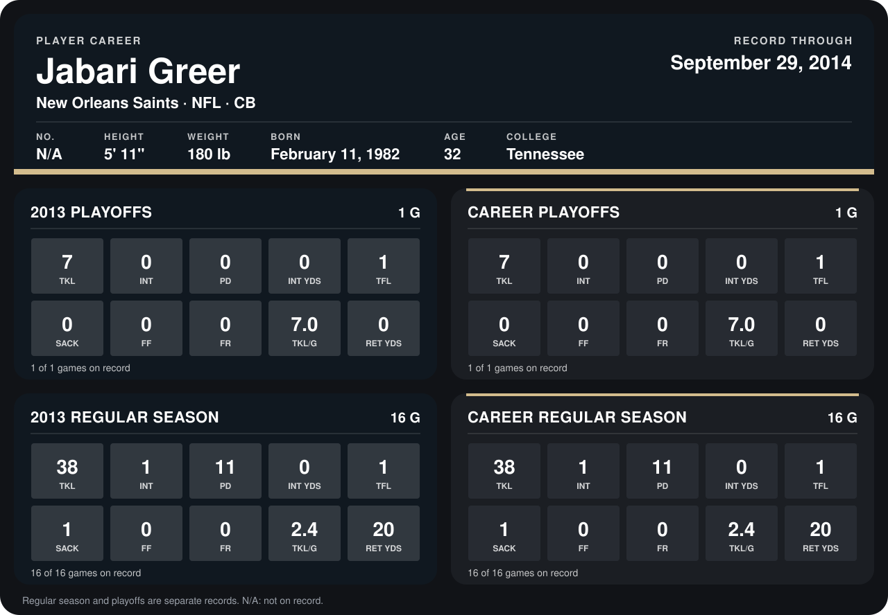

# Jabari Greer

## Career stats

### Regular season

| Season | Club | G | TKL | INT | PD | INT YDS | TFL | SACK | FF | FR | TKL/G | RET YDS |
|---|---|---:|---:|---:|---:|---:|---:|---:|---:|---:|---:|---:|
| 2013 | New Orleans Saints | 16 | 38 | 1 | 11 | 0 | 1 | 1 | 0 | 0 | 2.4 | 20 |
| **Career** |  | 16 | 38 | 1 | 11 | 0 | 1 | 1 | 0 | 0 | 2.4 | 20 |

### Playoffs

| Season | Club | G | TKL | INT | PD | INT YDS | TFL | SACK | FF | FR | TKL/G | RET YDS |
|---|---|---:|---:|---:|---:|---:|---:|---:|---:|---:|---:|---:|
| 2013 | New Orleans Saints | 1 | 7 | 0 | 0 | 0 | 1 | 0 | 0 | 0 | 7.0 | 0 |
| **Career** |  | 1 | 7 | 0 | 0 | 0 | 1 | 0 | 0 | 0 | 7.0 | 0 |

## Awards

None on record.

Records through January 4, 2014. Identity: his listed 2013 season roster data (no 2014 Weeks 1-4 roster row). [All New Orleans Saints players](README.md).
