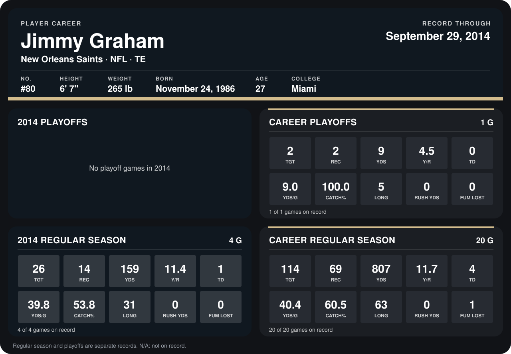

# Jimmy Graham

## Career stats

### Regular season

| Season | Team | Age | # | G | TGT | REC | YDS | Y/R | TD | YDS/G | CATCH% | LONG | RUSH YDS | FUM LOST |
|---|---|---:|---:|---:|---:|---:|---:|---:|---:|---:|---:|---:|---:|---:|
| 2013 | New Orleans Saints | 26 | 80 | 16 | 88 | 55 | 648 | 11.8 | 3 | 40.5 | 62.5 | 63 | 0 | 1 |
| 2014 | New Orleans Saints | 27 | 80 | 4 | 26 | 14 | 159 | 11.4 | 1 | 39.8 | 53.8 | 31 | 0 | 0 |
| **Career** |  |  |  | 20 | 114 | 69 | 807 | 11.7 | 4 | 40.4 | 60.5 | 63 | 0 | 1 |

### Playoffs

| Season | Team | Age | # | G | TGT | REC | YDS | Y/R | TD | YDS/G | CATCH% | LONG | RUSH YDS | FUM LOST |
|---|---|---:|---:|---:|---:|---:|---:|---:|---:|---:|---:|---:|---:|---:|
| 2013 | New Orleans Saints | 26 | 80 | 1 | 2 | 2 | 9 | 4.5 | 0 | 9.0 | 100.0 | 5 | 0 | 0 |
| **Career** |  |  |  | 1 | 2 | 2 | 9 | 4.5 | 0 | 9.0 | 100.0 | 5 | 0 | 0 |

## Awards

None on record.

Age is his age on the league's opening game of each season; # is the number listed for him that season with that team (2014: the card's rule; 2013: the 2013 season roster), N/A where no listing applies.

Records through September 28, 2014. Identity: listed 2014 roster data, Weeks 1-4; number: 2014 Week 1 roster. [All New Orleans Saints players](README.md).
