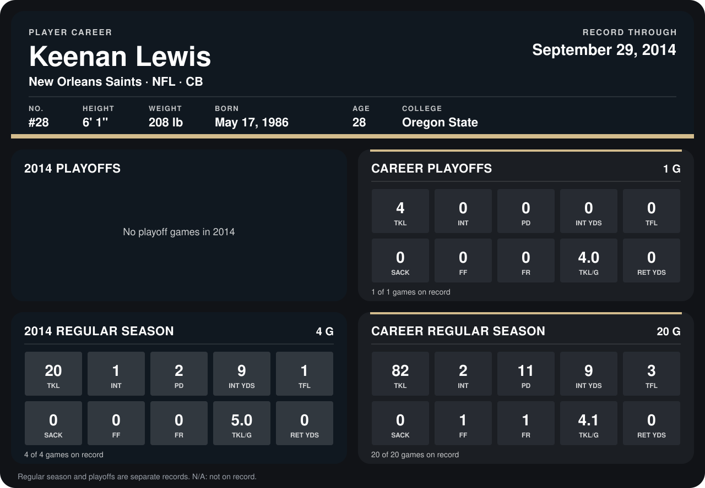

# Keenan Lewis

## Career stats

### Regular season

| Season | Club | G | TKL | INT | PD | INT YDS | TFL | SACK | FF | FR | TKL/G | RET YDS |
|---|---|---:|---:|---:|---:|---:|---:|---:|---:|---:|---:|---:|
| 2013 | New Orleans Saints | 16 | 62 | 1 | 9 | 0 | 2 | 0 | 1 | 1 | 3.9 | 0 |
| 2014 | New Orleans Saints | 4 | 20 | 1 | 2 | 9 | 1 | 0 | 0 | 0 | 5.0 | 0 |
| **Career** |  | 20 | 82 | 2 | 11 | 9 | 3 | 0 | 1 | 1 | 4.1 | 0 |

### Playoffs

| Season | Club | G | TKL | INT | PD | INT YDS | TFL | SACK | FF | FR | TKL/G | RET YDS |
|---|---|---:|---:|---:|---:|---:|---:|---:|---:|---:|---:|---:|
| 2013 | New Orleans Saints | 1 | 4 | 0 | 0 | 0 | 0 | 0 | 0 | 0 | 4.0 | 0 |
| **Career** |  | 1 | 4 | 0 | 0 | 0 | 0 | 0 | 0 | 0 | 4.0 | 0 |

## Awards

None on record.

Records through September 28, 2014. Identity: listed 2014 roster data, Weeks 1-4; number: 2014 Week 1 roster. [All New Orleans Saints players](README.md).
