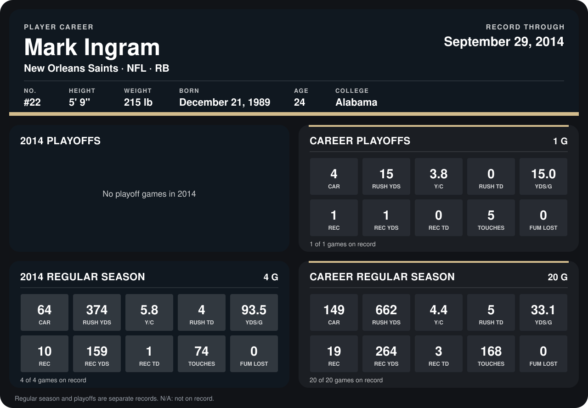

# Mark Ingram

## Career stats

### Regular season

| Season | Club | G | CAR | RUSH YDS | Y/C | RUSH TD | YDS/G | REC | REC YDS | REC TD | TOUCHES | FUM LOST |
|---|---|---:|---:|---:|---:|---:|---:|---:|---:|---:|---:|---:|
| 2013 | New Orleans Saints | 16 | 85 | 288 | 3.4 | 1 | 18.0 | 9 | 105 | 2 | 94 | 0 |
| 2014 | New Orleans Saints | 4 | 64 | 374 | 5.8 | 4 | 93.5 | 10 | 159 | 1 | 74 | 0 |
| **Career** |  | 20 | 149 | 662 | 4.4 | 5 | 33.1 | 19 | 264 | 3 | 168 | 0 |

### Playoffs

| Season | Club | G | CAR | RUSH YDS | Y/C | RUSH TD | YDS/G | REC | REC YDS | REC TD | TOUCHES | FUM LOST |
|---|---|---:|---:|---:|---:|---:|---:|---:|---:|---:|---:|---:|
| 2013 | New Orleans Saints | 1 | 4 | 15 | 3.8 | 0 | 15.0 | 1 | 1 | 0 | 5 | 0 |
| **Career** |  | 1 | 4 | 15 | 3.8 | 0 | 15.0 | 1 | 1 | 0 | 5 | 0 |

## Awards

None on record.

Records through September 28, 2014. Identity: listed 2014 roster data, Weeks 1-4; number: 2014 Week 1 roster. [All New Orleans Saints players](README.md).
