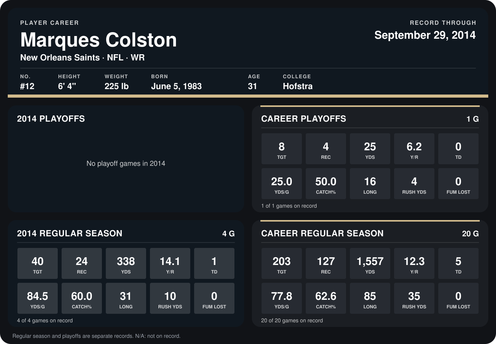

# Marques Colston

## Career stats

### Regular season

| Season | Club | G | TGT | REC | YDS | Y/R | TD | YDS/G | CATCH% | LONG | RUSH YDS | FUM LOST |
|---|---|---:|---:|---:|---:|---:|---:|---:|---:|---:|---:|---:|
| 2013 | New Orleans Saints | 16 | 163 | 103 | 1,219 | 11.8 | 4 | 76.2 | 63.2 | 85 | 25 | 0 |
| 2014 | New Orleans Saints | 4 | 40 | 24 | 338 | 14.1 | 1 | 84.5 | 60.0 | 31 | 10 | 0 |
| **Career** |  | 20 | 203 | 127 | 1,557 | 12.3 | 5 | 77.8 | 62.6 | 85 | 35 | 0 |

### Playoffs

| Season | Club | G | TGT | REC | YDS | Y/R | TD | YDS/G | CATCH% | LONG | RUSH YDS | FUM LOST |
|---|---|---:|---:|---:|---:|---:|---:|---:|---:|---:|---:|---:|
| 2013 | New Orleans Saints | 1 | 8 | 4 | 25 | 6.2 | 0 | 25.0 | 50.0 | 16 | 4 | 0 |
| **Career** |  | 1 | 8 | 4 | 25 | 6.2 | 0 | 25.0 | 50.0 | 16 | 4 | 0 |

## Awards

None on record.

Records through September 29, 2014. Identity: listed 2014 roster data, Weeks 1-4; number: 2014 Week 1 roster. [All New Orleans Saints players](README.md).
