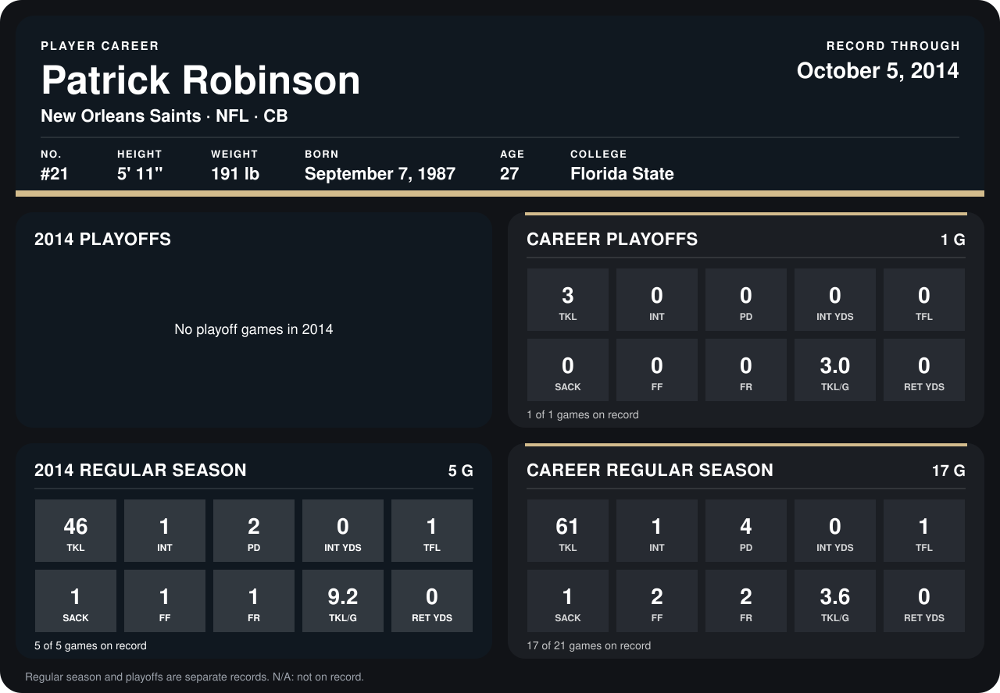

# Patrick Robinson

## Career stats

### Regular season

| Season | Club | G | TKL | INT | PD | INT YDS | TFL | SACK | FF | FR | TKL/G | RET YDS |
|---|---|---:|---:|---:|---:|---:|---:|---:|---:|---:|---:|---:|
| 2013 | New Orleans Saints | 12 | 15 | 0 | 2 | 0 | 0 | 0 | 1 | 1 | 1.2 | 0 |
| 2014 | New Orleans Saints | 5 | 46 | 1 | 2 | 0 | 1 | 1 | 1 | 1 | 9.2 | 0 |
| **Career** |  | 17 | 61 | 1 | 4 | 0 | 1 | 1 | 2 | 2 | 3.6 | 0 |

### Playoffs

| Season | Club | G | TKL | INT | PD | INT YDS | TFL | SACK | FF | FR | TKL/G | RET YDS |
|---|---|---:|---:|---:|---:|---:|---:|---:|---:|---:|---:|---:|
| 2013 | New Orleans Saints | 1 | 3 | 0 | 0 | 0 | 0 | 0 | 0 | 0 | 3.0 | 0 |
| **Career** |  | 1 | 3 | 0 | 0 | 0 | 0 | 0 | 0 | 0 | 3.0 | 0 |

## Awards

- NFC Defensive Player of the Week (2014, Week 2)

Records through October 5, 2014. Identity: listed 2014 roster data, Weeks 1-4; number: 2014 Week 1 roster. [All New Orleans Saints players](README.md).
