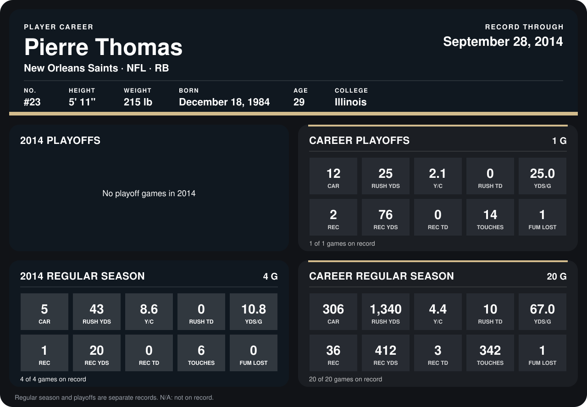

# Pierre Thomas

## Career stats

### Regular season

| Season | Club | G | CAR | RUSH YDS | Y/C | RUSH TD | YDS/G | REC | REC YDS | REC TD | TOUCHES | FUM LOST |
|---|---|---:|---:|---:|---:|---:|---:|---:|---:|---:|---:|---:|
| 2013 | New Orleans Saints | 16 | 301 | 1,297 | 4.3 | 10 | 81.1 | 35 | 392 | 3 | 336 | 1 |
| 2014 | New Orleans Saints | 4 | 5 | 43 | 8.6 | 0 | 10.8 | 1 | 20 | 0 | 6 | 0 |
| **Career** |  | 20 | 306 | 1,340 | 4.4 | 10 | 67.0 | 36 | 412 | 3 | 342 | 1 |

### Playoffs

| Season | Club | G | CAR | RUSH YDS | Y/C | RUSH TD | YDS/G | REC | REC YDS | REC TD | TOUCHES | FUM LOST |
|---|---|---:|---:|---:|---:|---:|---:|---:|---:|---:|---:|---:|
| 2013 | New Orleans Saints | 1 | 12 | 25 | 2.1 | 0 | 25.0 | 2 | 76 | 0 | 14 | 1 |
| **Career** |  | 1 | 12 | 25 | 2.1 | 0 | 25.0 | 2 | 76 | 0 | 14 | 1 |

## Awards

None on record.

Records through September 28, 2014. Identity: listed 2014 roster data, Weeks 1-4; number: 2014 Week 1 roster. [All New Orleans Saints players](README.md).
